Unsere Duplexwohnung mit 63 m², 3 Schlafzimmern, Terrasse und Parkplatz (2 Plätze, mit Ladestation), 2010 gebaut (sehr guter Wärmekomfort), liegt ideal, [10-15 Gehminuten (bergab) vom Zentrum von Valloire](https://www.viewgpx.com/route/bMjNJt5p) (Details auf den Seiten [Winter](/ski) und [Sommer](/summer)), von den Geschäften, Gondelbahnen und Aktivitäten. Und doch ist es hier herrlich ruhig, abseits vom Trubel des Dorfzentrums, ohne Verkehr und ohne Lärm von Nachbarn.


In der Nähe
Anreise


Auf der Hauptebene befinden sich ein grosser Wohn-, Ess- und Kochbereich, ein Eingang, ein separates WC und eine grosse überdachte Terrasse von 20 m². Die Etage darunter umfasst 2 helle Doppelzimmer, 1 Kajütenzimmer mit 2 Etagenbetten, 1 Badezimmer und 1 separates WC.

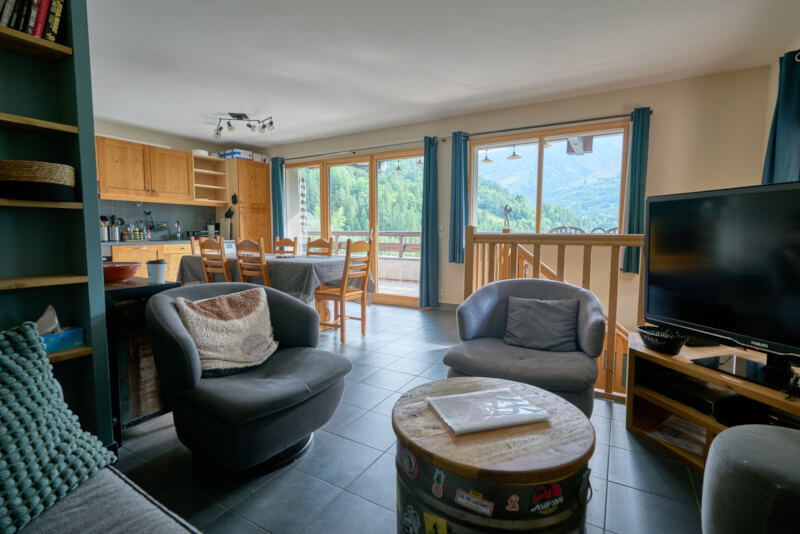

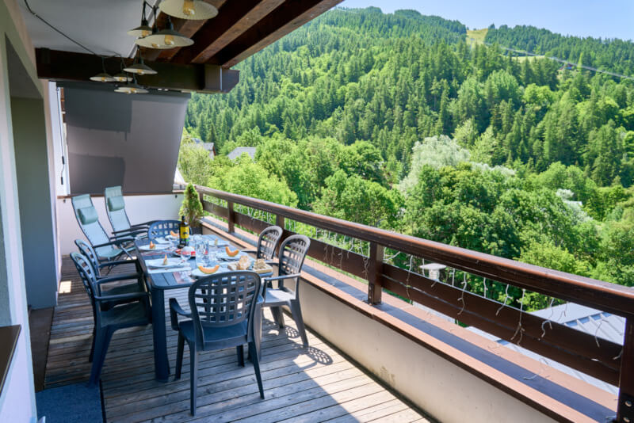

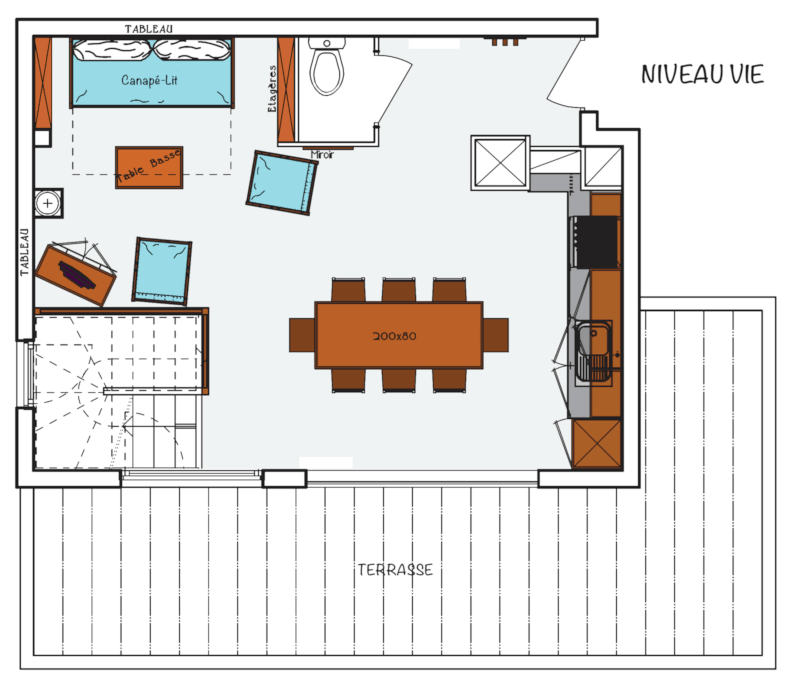

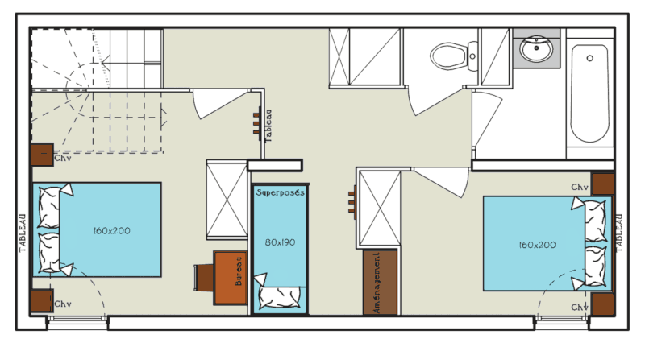

### Schlafplätze

Bettwaren mit Duvets oder Decken nach Wahl (Bettwäsche und Handtücher gegen Aufpreis zu mieten):

- Wohnzimmer (30 m²): 1 Schlafsofa 150x190 cm
- Schlafzimmer 1 (10 m²): 1 Queensize-Bett 160x200 cm + 1 Reisebett  + 1 zusätzliche Einzelmatratze
- Schlafzimmer 2 (7 m²): 1 Queensize-Bett 160x200 cm
- Kajüte: 2 Etagenbetten 80x190 cm

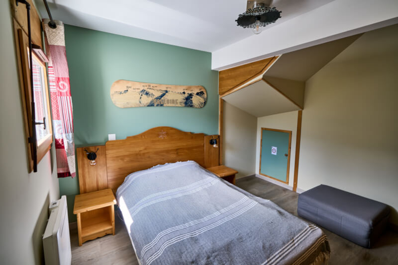

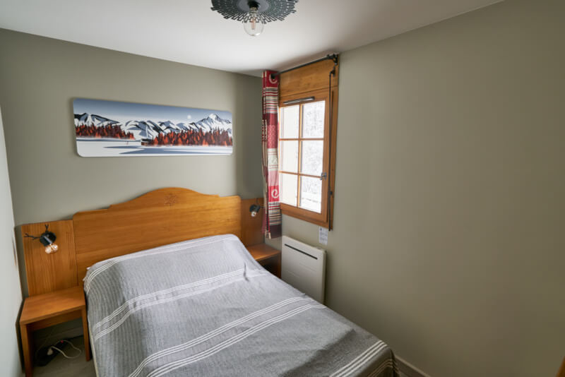

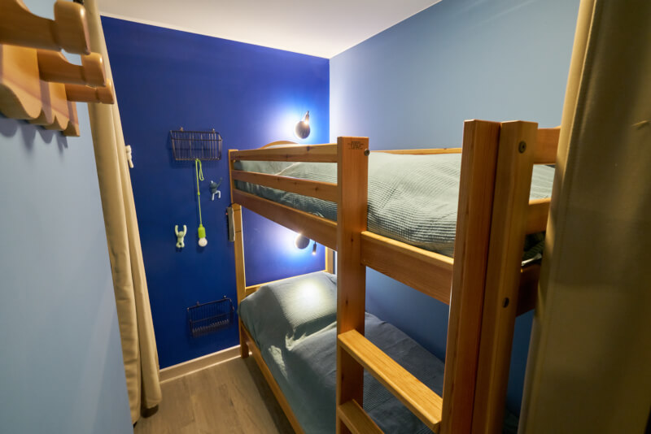

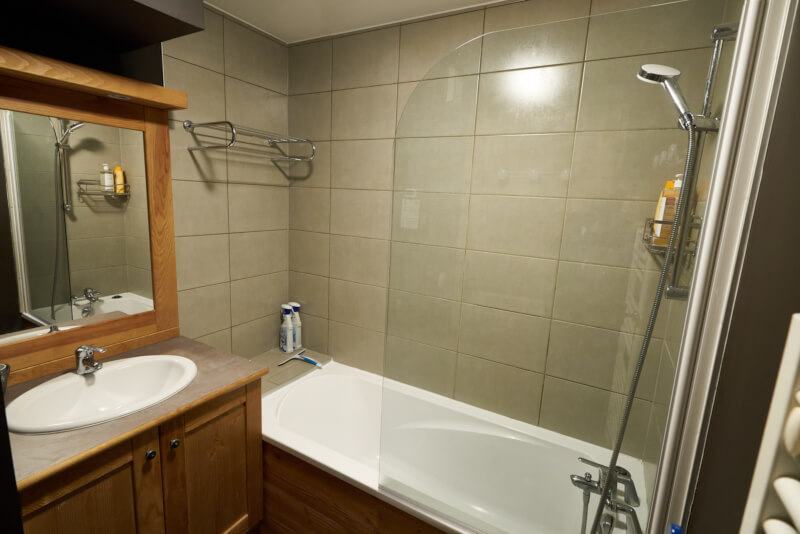

### Küche

- Backofen & Mikrowelle
- Geschirrspüler
- Kühlschrank mit Gefrierfach
- Induktionskochfeld mit 3 Zonen
- Wasserkocher & Toaster
- Filterkaffeemaschine & Nespresso-Maschine
- Raclette-, Plancha- und Fondue-Geräte
- Waschmaschine

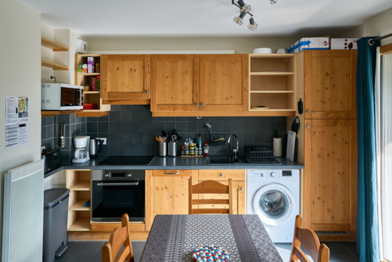

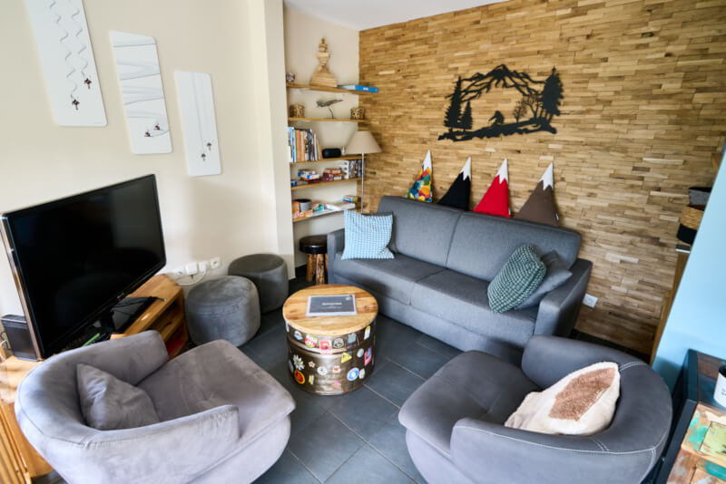

### Ausstattung/Hinweise

-  Maximale Belegung: 8 Personen
-  Fläche: 63 m² + Terrasse von 20 m² (Gartentisch und -stühle, Zero-Gravity-Liegestühle)
-  Ausrichtung: Südwesten
-  Skischrank im Erdgeschoss und Handschuhtrockner in der Wohnung
-  2 private Parkplätze mit 7-kW-Ladestation für Elektroautos (eine Station für beide)
-  WLAN 6 mit superschnellem Glasfaseranschluss
-  47-Zoll-Fernseher mit Netflix, Prime Video und YouTube
-  Nichtraucherwohnung, auch keine E-Zigaretten (auf der Terrasse erlaubt)
-  Haustiere sind willkommen (höchstens 2)


Winterstimmung
Sommerstimmung


Hier klicken zum Buchen


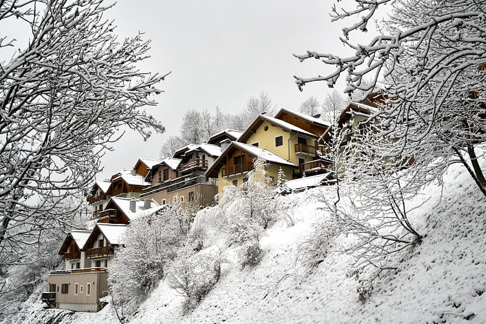
