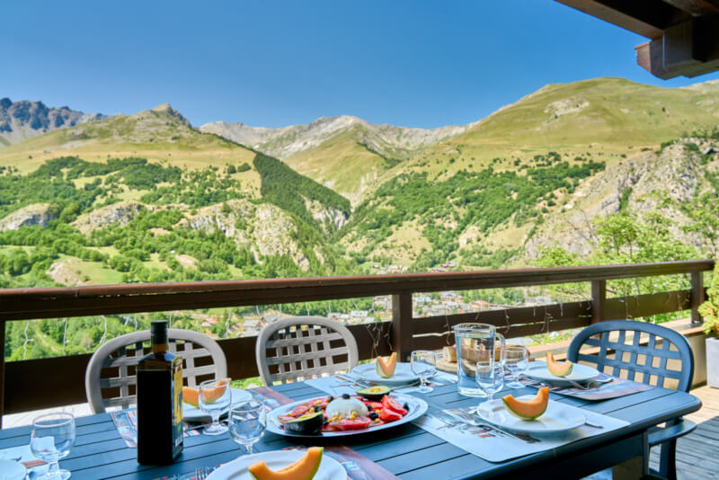

Our 680 sqft (63 m²) duplex, with 3 bedrooms, terrace and parking (2 spaces, including a 7 kW EV charging point), constructed in 2010 for optimal thermal comfort, occupies an ideal location just [a 10-15 minute walk (downhill)](https://www.viewgpx.com/route/bMjNJt5p) from Valloire's center (detailed information available on our [winter](/ski) and [summer](/summer) pages), shops, cable cars, and activities. Despite this proximity, it boasts a serene tranquility, free from the disturbances of traffic and neighboring noise.


Commodities
How to get there


The main level hosts a spacious living/dining room-kitchen featuring an entrance, a separate WC, and a generous 215 sqft covered terrace. The lower second floor accommodates 2 double bedrooms, a cabin bedroom with 2 bunk beds, 1 bathroom, and another separate WC.

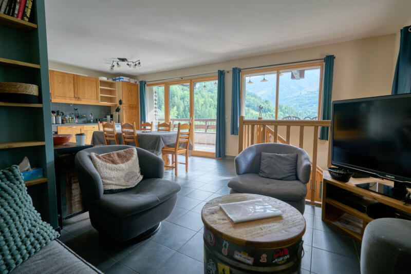

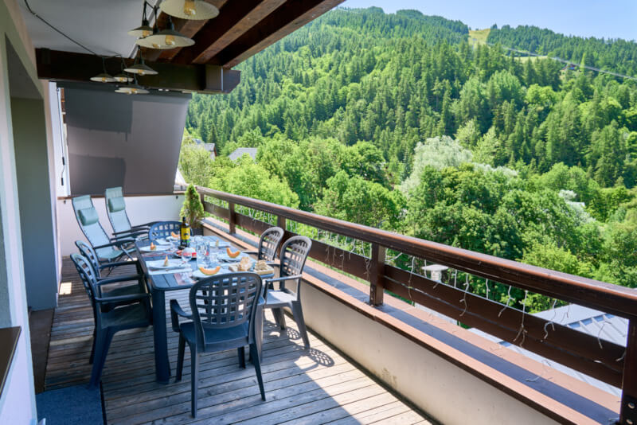

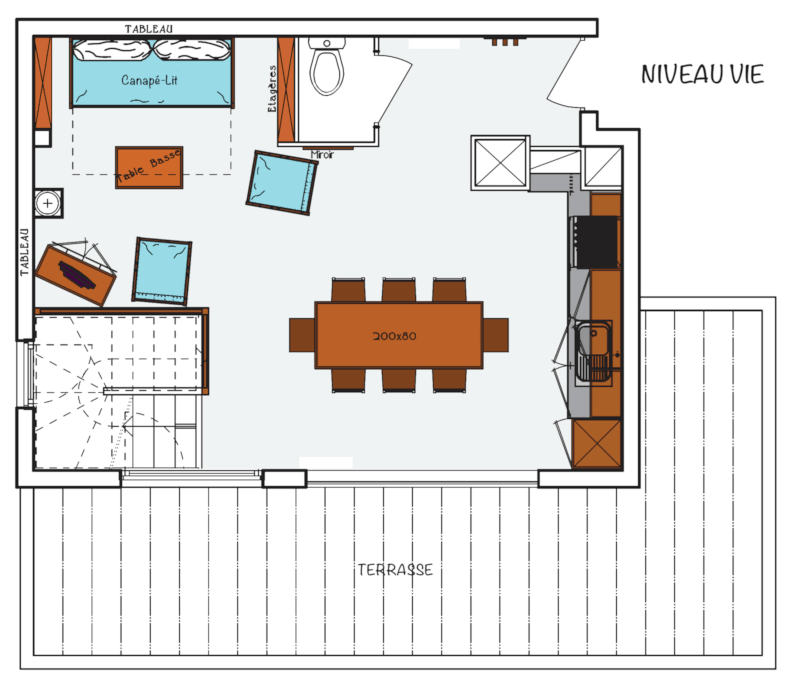

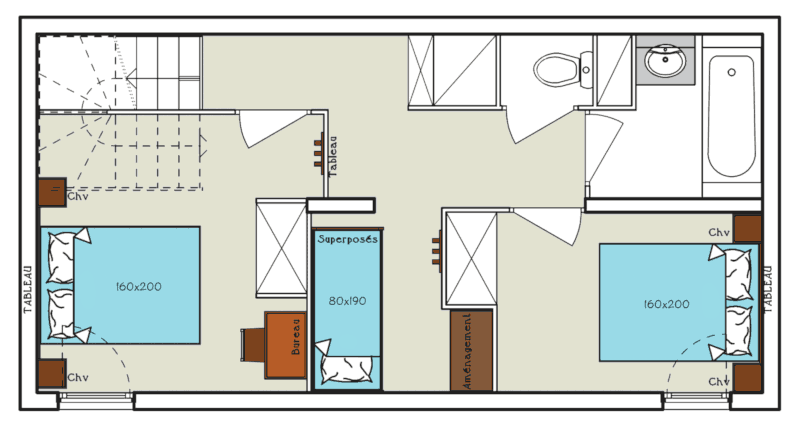

### Beds

Bedding with duvets or blankets at your choice (sheets and towels not provided, available for rent at extra cost) :

- living room (320 sqft) : 1 sofa bed of 150x190 cm
- bedroom 1 (110 sqft) : 1 queen-size bed of 160x200 cm + 1 child's folding bed  + 1 foldable mattress
- bedroom 2 (75 sqft) : 1 queen-size bed of 160x200 cm
- cabin room : 2 bunk beds of 80x190 cm

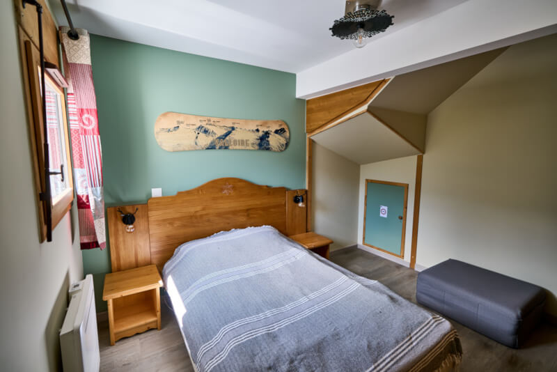

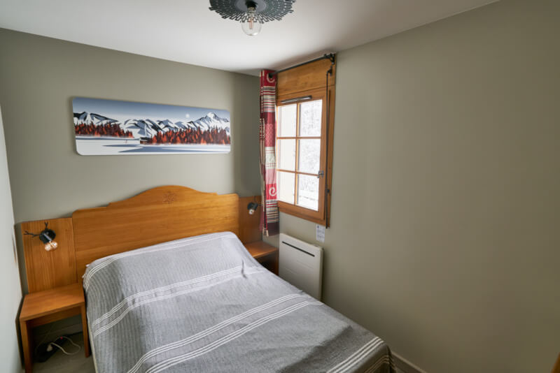

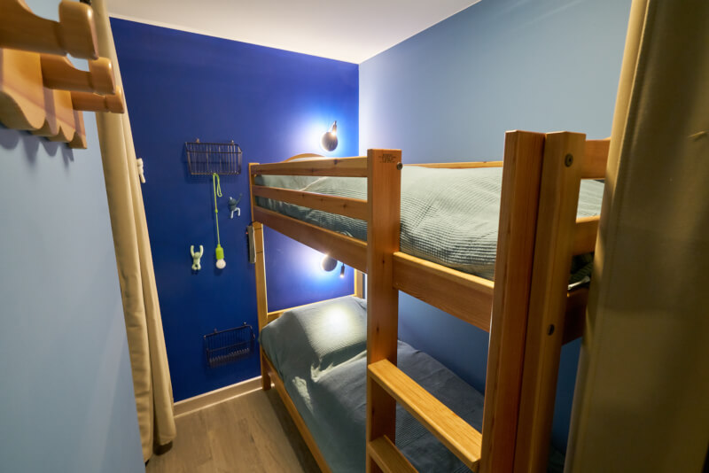

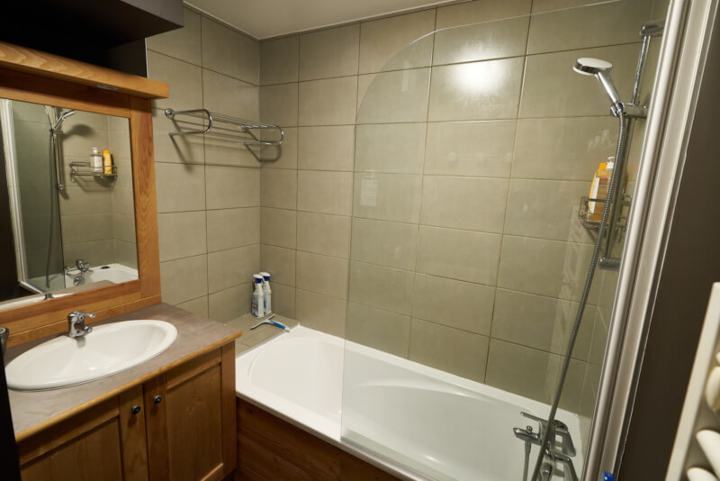

### Kitchen

- oven & microwave
- dishwasher
- refrigerator with freezer
- 3 zones induction hob
- kettle & toaster
- filter coffee machine & Nespresso machine
- raclette & fondue machines / plancha / grill
- washing machine

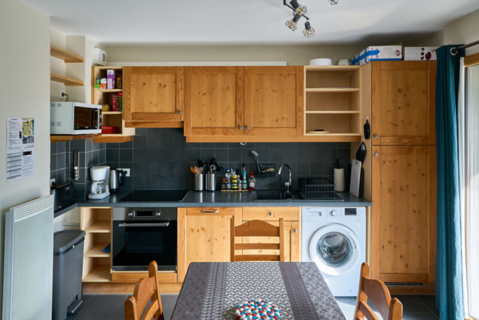

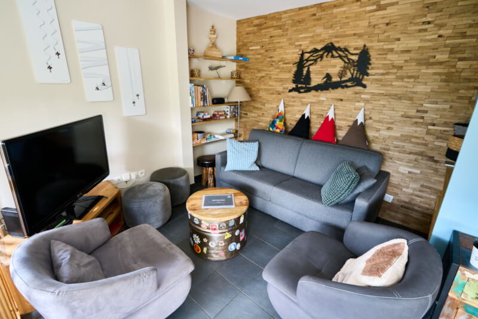

### Services/Observations

-  Maximum capacity: 8 people
-  Surface area: 680 sqft + terrace of 215 sqft (garden table and chairs, sunbathing)
-  Orientation: South-West
-  Ski locker on the ground floor and glove dryer in the apartment
-  2 private parking spaces with a 7 kW EV charging point (one charger for both)
-  Wifi 6 with high-speed fiber optic
-  Full-HD 47" television with Netflix, Prime Video and YouTube
-  Non-smoking apartment, vaping included (tolerated on the terrace)
-  Pets allowed (2 maximum)


Winter atmosphere
Summer atmosphere


Click here to make a reservation


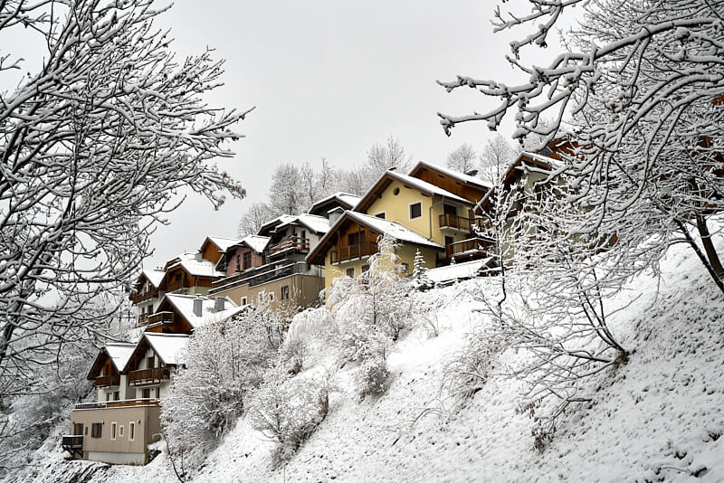
