Notre duplex de 63 m², comportant 3 chambres avec terrasse et parking (2 places, avec borne de recharge), et construit en 2010 (très bon confort thermique), est idéalement situé à [10-15 minutes à pied (en descente) du centre de Valloire](https://www.viewgpx.com/route/bMjNJt5p) (voir le détail sur les pages [hiver](/ski) et [été](/summer)), des commerces, télécabines et activités, tout en étant parfaitement au calme, à l'écart du boucan du centre-village, sans circulation ni bruits de voisinage.


A proximité
Comment venir


Il est composé au niveau principal d'un grand séjour-salle-à-manger-cuisine, d'une entrée, d'un WC séparé, et d'une grande terrasse abritée de 20m². L'étage au dessous comporte 2 chambres doubles lumineuses, 1 chambre cabine avec 2 lits superposés, 1 salle-de-bain et 1 WC séparé.

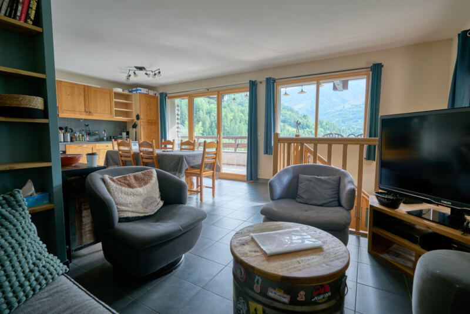

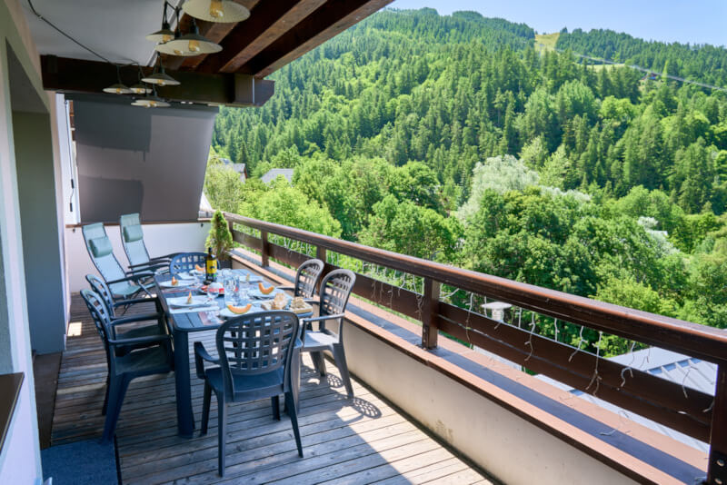

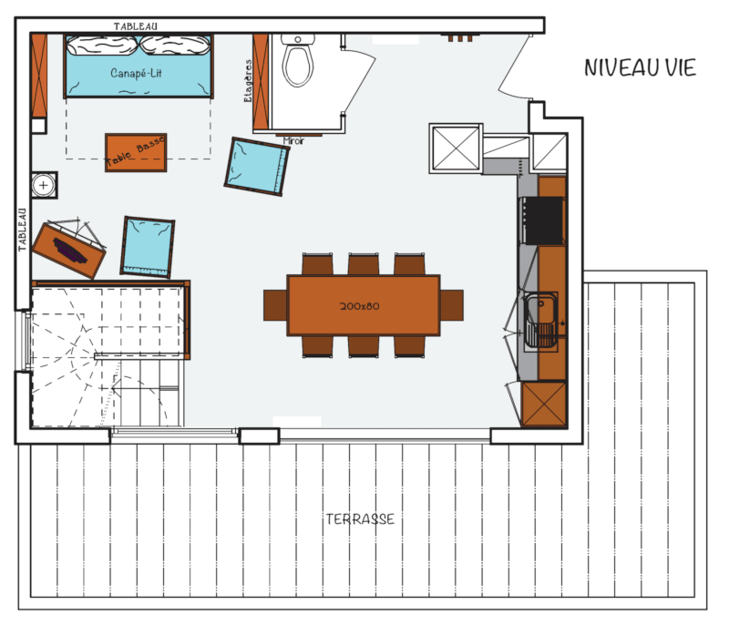

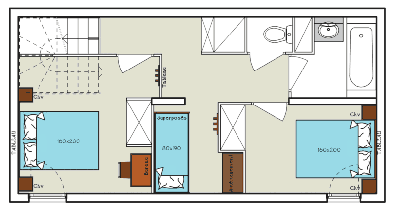

### Couchages

Literie avec couettes ou couvertures au choix (draps et serviettes en location en sus) :

- séjour (30 m²) : 1 canapé convertible de 150x190 cm
- chambre 1 (10 m²) : 1 lit queen size de 160x200 cm + 1 lit parapluie  + 1 matelas d'appoint 1 place
- chambre 2 (7 m²) : 1 lit queen size de 160x200 cm
- cabine : 2 lits superposés de 80x190 cm

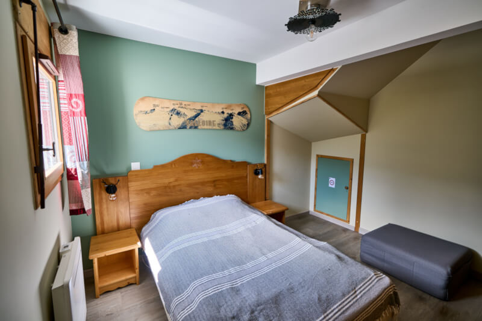

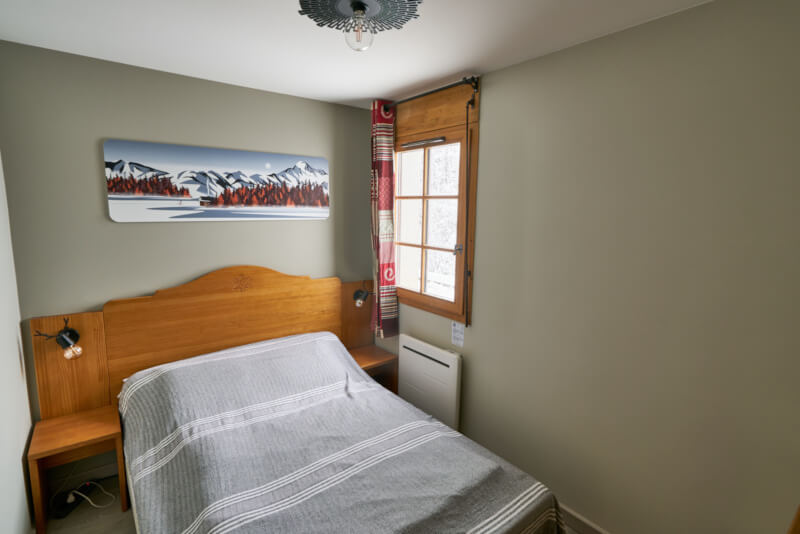

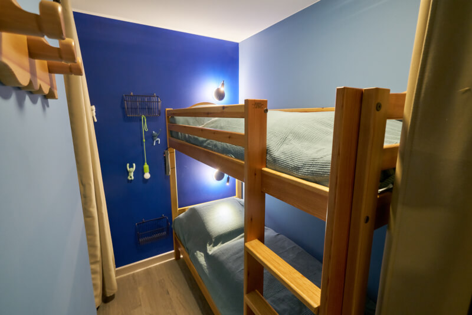

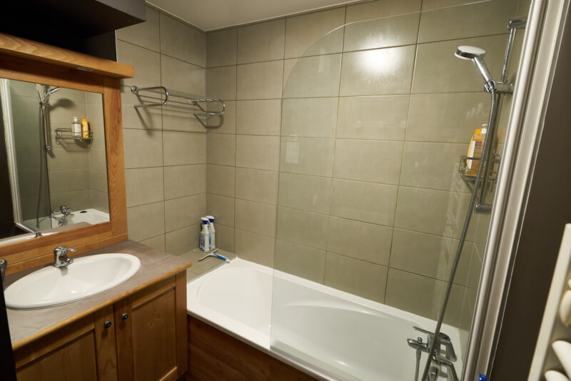

### Cuisine

- four & four micro-ondes
- lave-vaisselle
- réfrigérateur avec congélateur
- plaque à induction 3 zones
- bouilloire & toaster
- cafetière à filtre & cafetière Nespresso
- appareils à raclette / plancha / fondue
- lave-linge

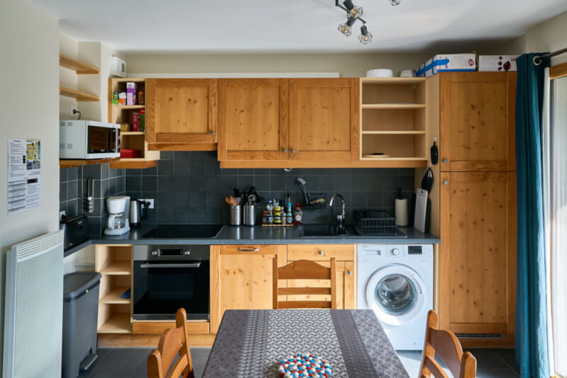

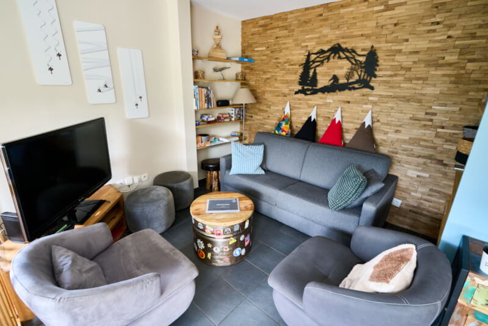

### Services/Observations

-  Capacité maximum : 8 personnes
-  Superficie : 63 m² + terrasse de 20m² (table et chaises de jardin, transats zéro gravité)
-  Orientation : Sud-Ouest
-  Casier à skis au rez-de-chaussée et séchoir à gants dans l'appartement
-  2 places de parking privées avec borne de charge IRVE 7 kW (une borne pour les deux)
-  Wifi 6 avec fibre optique très haut débit
-  Télévision 47 pouces avec Netflix, Prime Video et YouTube
-  Appartement non fumeur, y compris vaporette (toléré sur la terrasse)
-  Les animaux de compagnie sont les bienvenus (2 maximum)


Ambiance hiver
Ambiance été


Cliquez ici pour réserver


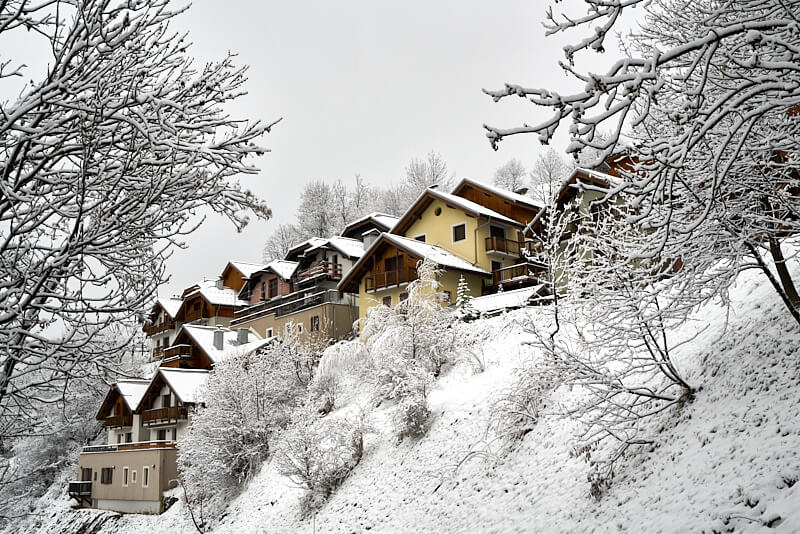
