Il nostro duplex di 63 m², con 3 camere, terrazza e parcheggio (2 posti, con colonnina di ricarica), costruito nel 2010 (ottimo comfort termico), si trova in posizione ideale, a [10-15 minuti a piedi (in discesa) dal centro di Valloire](https://www.viewgpx.com/route/bMjNJt5p) (vedi i dettagli nelle pagine [inverno](/ski) ed [estate](/summer)), dai negozi, dalle cabinovie e dalle attività, pur restando perfettamente tranquillo, lontano dal trambusto del centro del paese, senza traffico né rumori di vicinato.


Nei dintorni
Come arrivare


Il livello principale comprende un grande soggiorno con zona pranzo e cucina, un ingresso, un WC separato e una grande terrazza coperta di 20 m². Il piano inferiore comprende 2 camere matrimoniali luminose, 1 camera a cabina con 2 letti a castello, 1 bagno e 1 WC separato.

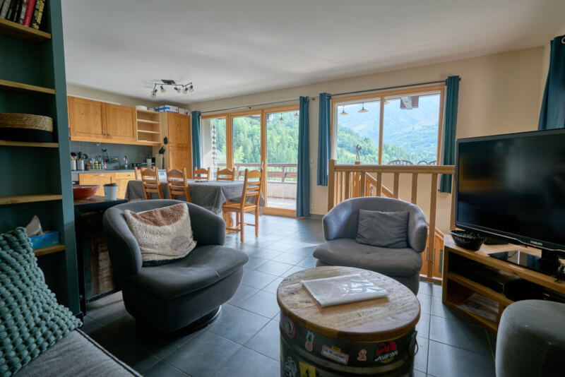

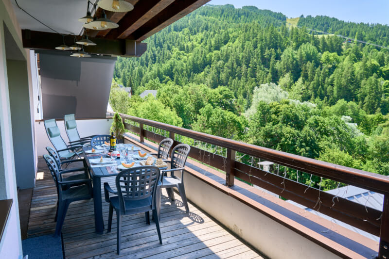

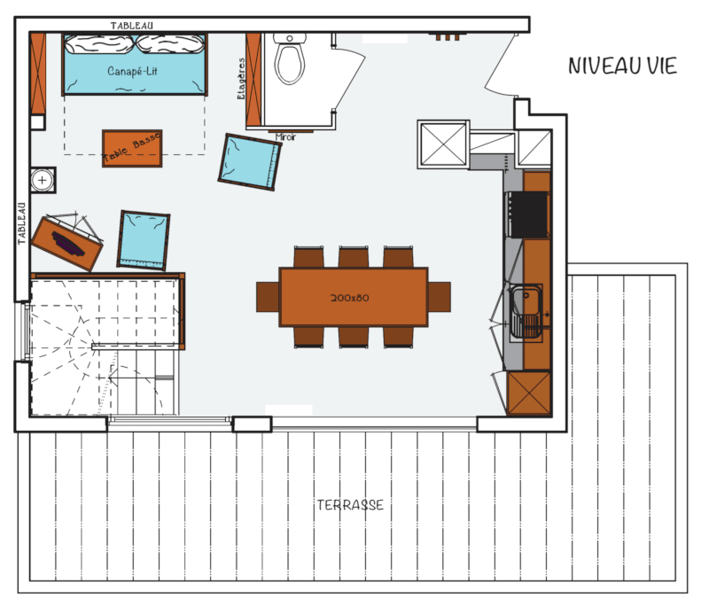

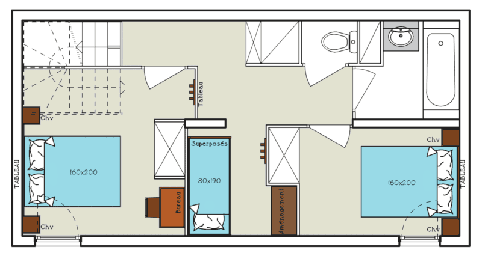

### Posti letto

Biancheria da letto con piumoni o coperte a scelta (lenzuola e asciugamani a noleggio con supplemento):

- soggiorno (30 m²): 1 divano letto da 150x190 cm
- camera 1 (10 m²): 1 letto queen size da 160x200 cm + 1 lettino da viaggio  + 1 materasso singolo aggiuntivo
- camera 2 (7 m²): 1 letto queen size da 160x200 cm
- cabina: 2 letti a castello da 80x190 cm

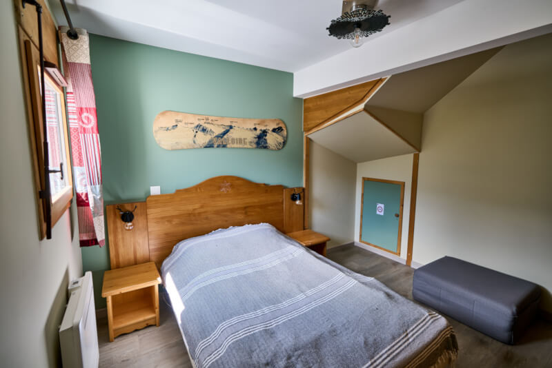

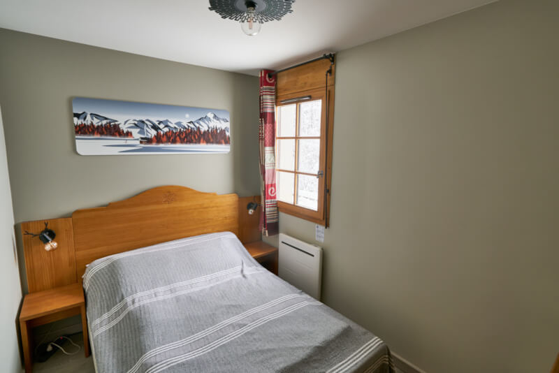

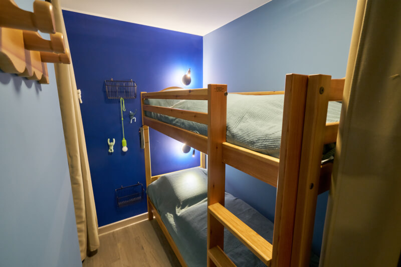

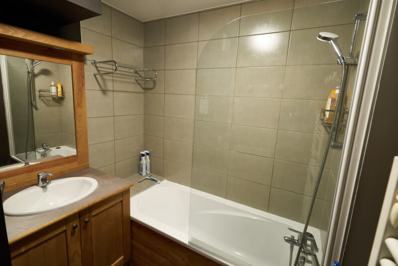

### Cucina

- forno & forno a microonde
- lavastoviglie
- frigorifero con congelatore
- piano a induzione a 3 zone
- bollitore & tostapane
- macchina da caffè americano & macchina Nespresso
- apparecchi per raclette / plancha / fonduta
- lavatrice

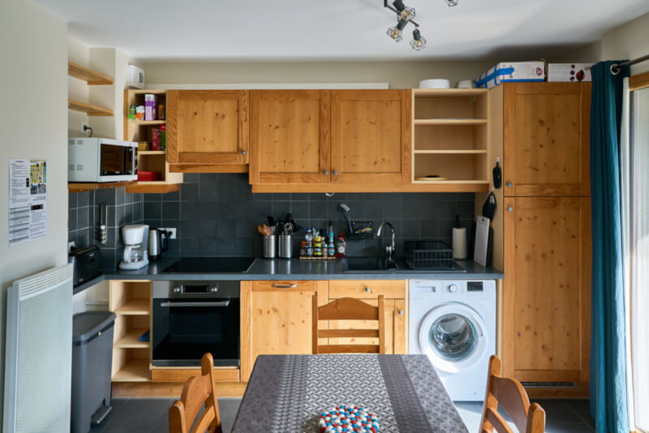

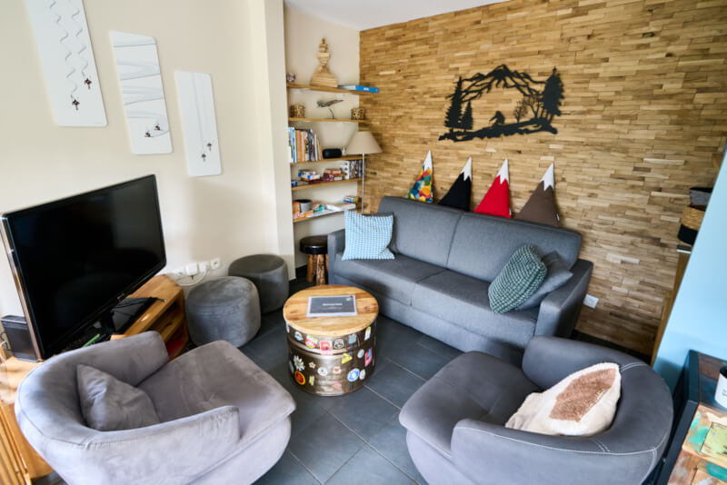

### Servizi/Osservazioni

-  Capienza massima: 8 persone
-  Superficie: 63 m² + terrazza di 20 m² (tavolo e sedie da giardino, sdraio zero gravity)
-  Esposizione: sud-ovest
-  Armadietto per gli sci al piano terra e asciugaguanti nell'appartamento
-  2 posti auto privati con colonnina di ricarica da 7 kW per auto elettriche (una colonnina per entrambi)
-  Wifi 6 con fibra ottica ultraveloce
-  Televisore da 47 pollici con Netflix, Prime Video e YouTube
-  Appartamento per non fumatori, sigaretta elettronica compresa (tollerata in terrazza)
-  Gli animali domestici sono i benvenuti (massimo 2)


Atmosfera invernale
Atmosfera estiva


Clicca qui per prenotare


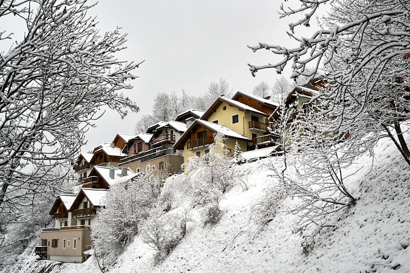
