Onze duplex van 63 m², met 3 slaapkamers, terras en parking (2 plaatsen, met laadpaal), gebouwd in 2010 (zeer goed thermisch comfort), ligt ideaal op [10-15 minuten wandelen (bergaf) van het centrum van Valloire](https://www.viewgpx.com/route/bMjNJt5p) (zie de details op de pagina's [winter](/ski) en [zomer](/summer)), van de winkels, gondels en activiteiten. Toch is het er heerlijk rustig, weg van de drukte van het dorpscentrum, zonder verkeer of burenlawaai.


In de buurt
Bereikbaarheid


Op het hoofdniveau vindt u een grote woonkamer met eethoek en keuken, een inkomhal, een apart toilet en een groot overdekt terras van 20 m². De verdieping eronder telt 2 lichte tweepersoonskamers, 1 kajuitkamer met 2 stapelbedden, 1 badkamer en 1 apart toilet.

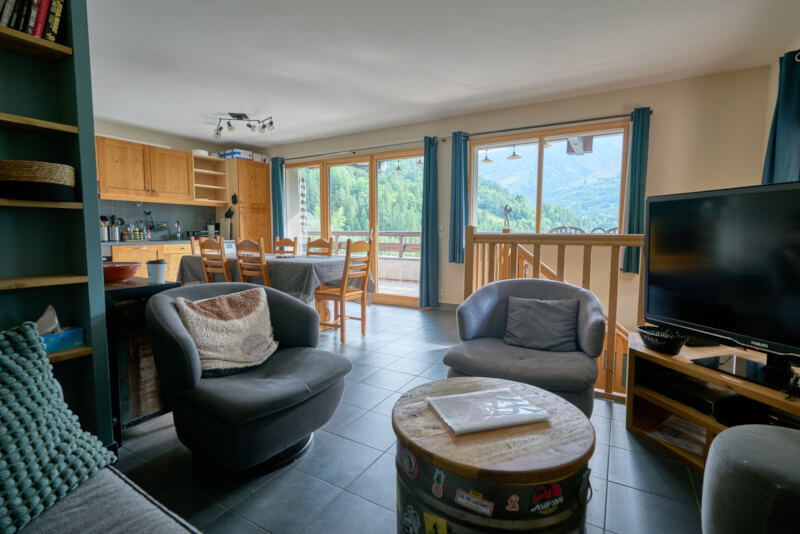

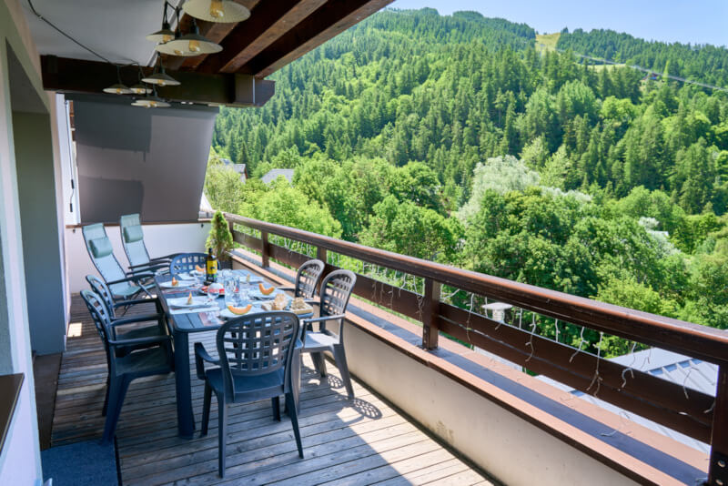

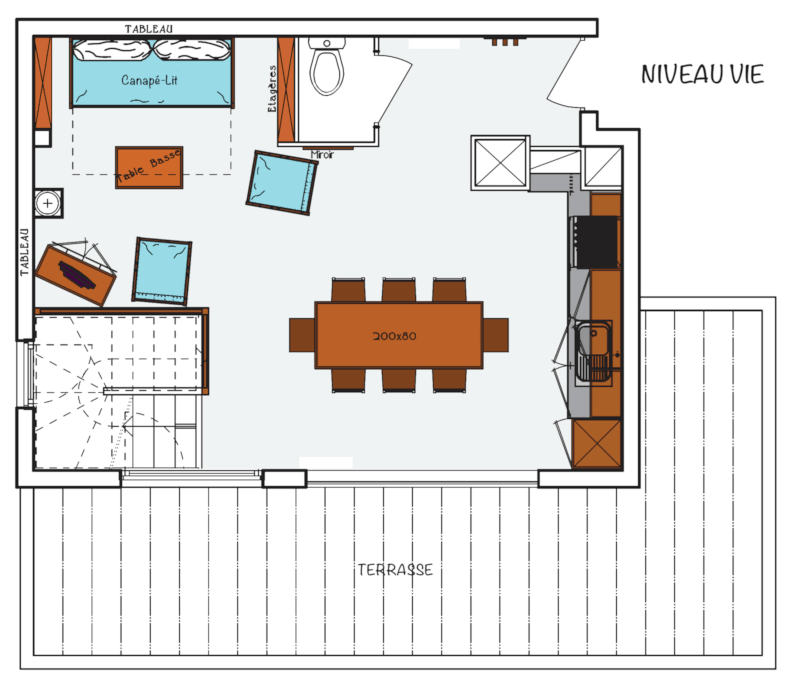

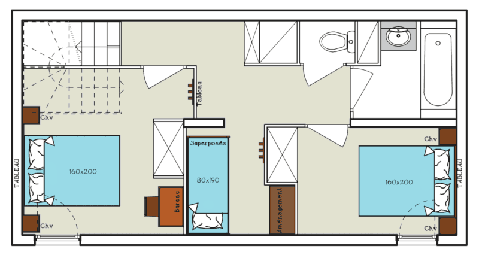

### Slaapplaatsen

Beddengoed met dekbedden of dekens naar keuze (lakens en handdoeken te huur tegen meerprijs):

- woonkamer (30 m²): 1 slaapbank van 150x190 cm
- slaapkamer 1 (10 m²): 1 queensize bed van 160x200 cm + 1 reisbedje  + 1 extra eenpersoonsmatras
- slaapkamer 2 (7 m²): 1 queensize bed van 160x200 cm
- kajuit: 2 stapelbedden van 80x190 cm

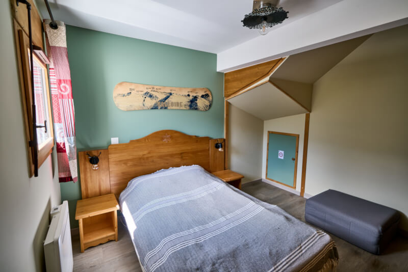

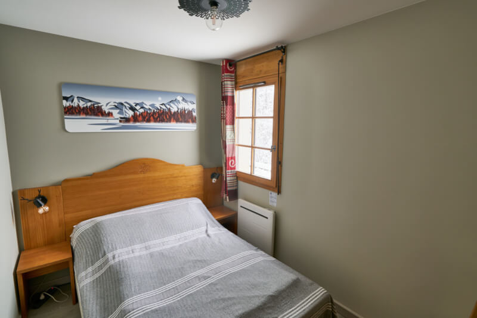

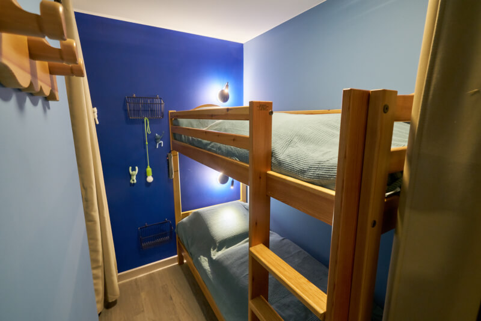

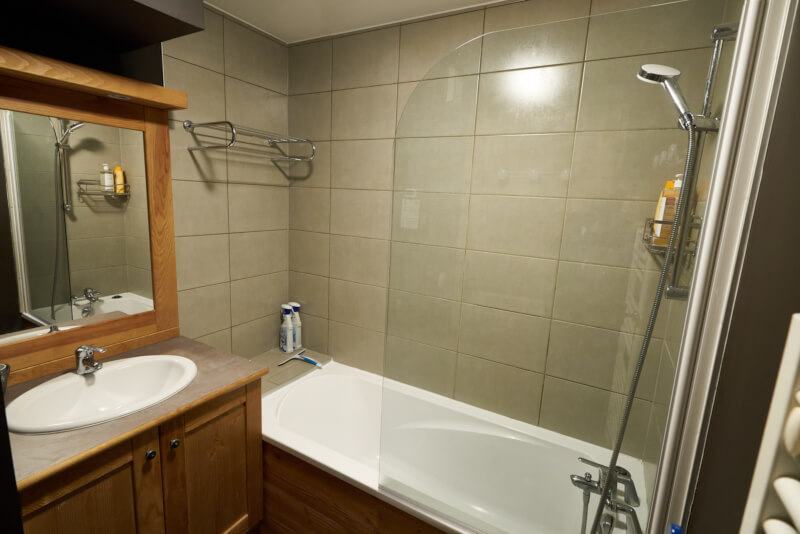

### Keuken

- oven & microgolfoven
- vaatwasser
- koelkast met diepvriezer
- inductiekookplaat met 3 zones
- waterkoker & broodrooster
- filterkoffiezetapparaat & Nespresso-apparaat
- raclette-, plancha- en fondueset
- wasmachine

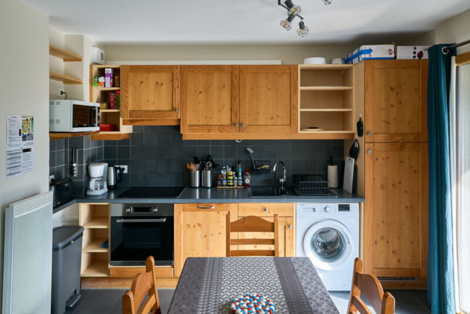

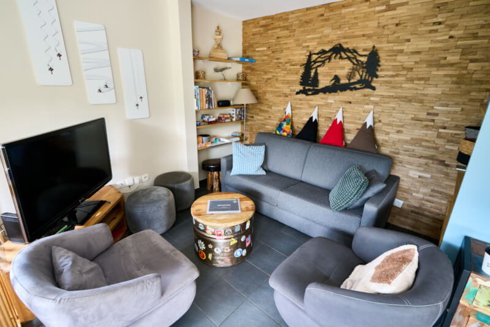

### Voorzieningen/Opmerkingen

-  Maximale capaciteit: 8 personen
-  Oppervlakte: 63 m² + terras van 20 m² (tuintafel en -stoelen, zero-gravity ligstoelen)
-  Oriëntatie: zuidwest
-  Skikast op het gelijkvloers en handschoenendroger in het appartement
-  2 privéparkeerplaatsen met laadpaal van 7 kW voor elektrische wagens (één paal voor beide)
-  Wifi 6 met supersnelle glasvezel
-  Televisie van 47 inch met Netflix, Prime Video en YouTube
-  Rookvrij appartement, ook geen e-sigaret (toegestaan op het terras)
-  Huisdieren zijn welkom (maximaal 2)


Wintersfeer
Zomersfeer


Klik hier om te reserveren


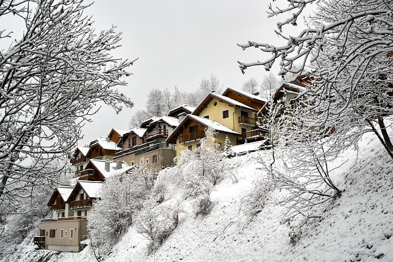
