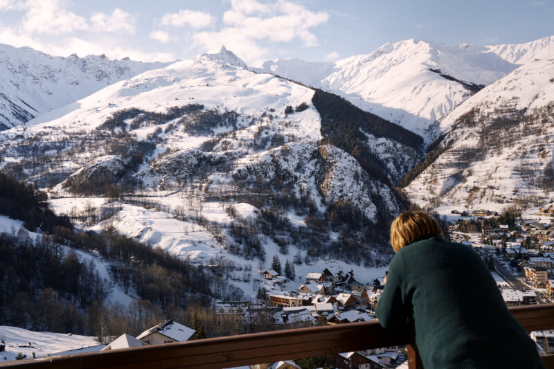
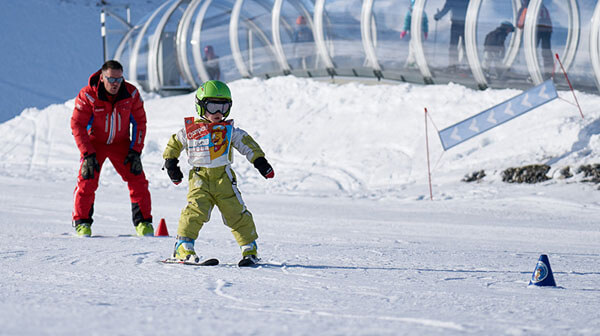
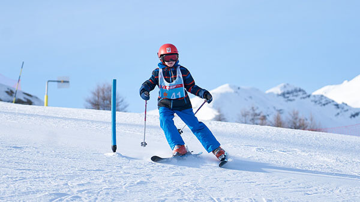
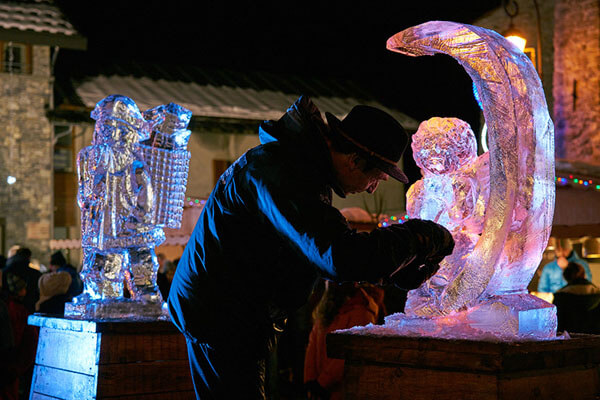
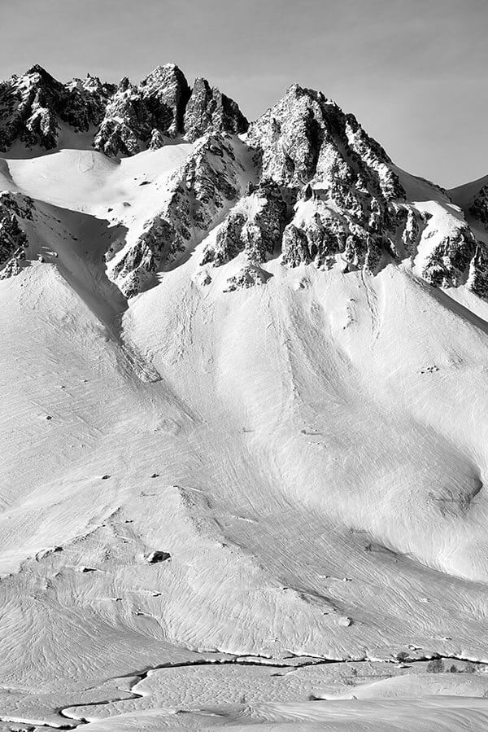

Stellen Sie sich einen aufregenden Wintermorgen vor! Adrien, 9 Jahre alt, muss um 9.15 Uhr in der Skischule sein. Um 8.50 Uhr verlassen Sie die Wohnung, ziehen Ihre Skischuhe an und nehmen Ihre Ski. Ab zur Haltestelle des Gratis-Skibusses, direkt vor den Chalets. Um 9.10 Uhr sind Sie an der Talstation der Gondelbahnen. Adrien fährt mit seiner Gruppe los, und der Rest der Familie muss nur noch hinauffahren, um die Hänge hinunterzusausen: Ein grossartiger Tag in den Bergen steht bevor!



[Valloire](https://www.valloire.net/en/) verbindet die Vorzüge eines familiären, überschaubaren und lebendigen Ferienorts mit denen eines grossen Skigebiets mit 160 km Pisten an 5 Berghängen und modernsten Bergbahnen. Und für alle, die nie genug bekommen: [Les 3 Vallées](https://www.les3vallees.com/de) sind nur 35 Autominuten entfernt!

### Ski & Snowboard

Das Angebot an [Winteraktivitäten](https://www.valloire.net/en/profiter-de-valloire/le-ski/) ist riesig:

- Für Snowboarder ein Snowpark auf 2300 m Höhe.
- 10 km präparierte [Langlaufloipen](https://www.valloire.net/en/profiter-de-valloire/le-ski/la-glisse-pour-tous/ski-de-fond/).
- Zwei [Skischulen (ESF und ESI)](https://www.valloire.net/en/profiter-de-valloire/le-ski/se-preparer-a-skier/apprendre-le-ski-a-valloire/) mit 140 Skilehrern und 3 Kindergärten sowie unabhängige Skilehrer.

Und wenn Ihnen das alles nicht genügt: Die Talstation der Gondelbahn in [Les 3 Vallées](https://www.les3vallees.com/de) (Courchevel, Méribel, Les Menuires, Val Thorens, Orelle), dem grössten Skigebiet der Welt mit 600 km Pisten, geöffnet von November bis Mai, ist nur 35 Autominuten entfernt!

### Weitere Aktivitäten

#### vor Ort

-  [Snake Gliss](https://www.valloire.net/en/sit/descente-en-snake-gliss-grande-aventure-388984/)
-  [Schneeschuhwanderungen](https://www.valloire.net/en/profiter-de-valloire/activites-outdoor/balades-a-pied-ou-en-raquettes-a-valloire/)
-  [Mountain Kart](https://www.valloire.net/en/actualites/descente-en-mountain-kart-lhiver-5413556/)
-  [Langlauf](https://www.valloire.net/en/profiter-de-valloire/le-ski/la-glisse-pour-tous/ski-de-fond/)
-  [Eisbahn](https://www.valloire.net/en/famille-plus/patinoire-philippe-candeloro-93457/)
-  [Trailrunning](https://www.valloire.net/en/trail/le-trail-avec-rando-montagne-4620573/)
-  [Spa - Sens des Cimes](https://www.les-sens-des-cimes.com/)
-  [Spa & Gym - Val'Form](https://www.valloire.net/en/profiter-de-valloire/bien-etre/)
-  [Bowling, Billard & Arcade](https://www.valloire.net/en/sit/bowling-le-mafayo-371455/)
-  [und Dutzende weitere Aktivitäten!](https://www.valloire.net/en/profiter-de-valloire/)

#### in weniger als einer Stunde

-  [Freizeitpark Valmigliss](https://www.valmigliss.com/copie-de-accueil-ete) (25 Min.)
-  [Orelle - Val Thorens - Les 3 Vallées](https://orelle.net/ski-resort/ski-area) (35 Min.)
-  [Espace Alu](https://espacealu.fr/Besuch-auf-Deutsch.htm) (35 Min.)
-  [Opinel-Museum](https://www.opinel.com/de-int/das-museum) (45 Min.)
-  [Norma Loops (Rodelbahn, 4 Jahreszeiten)](https://normaloops.fr/) (55 Min.)
-  und Dutzende weitere Aktivitäten!


Die Wohnung entdecken
Verfügbarkeit ansehen

