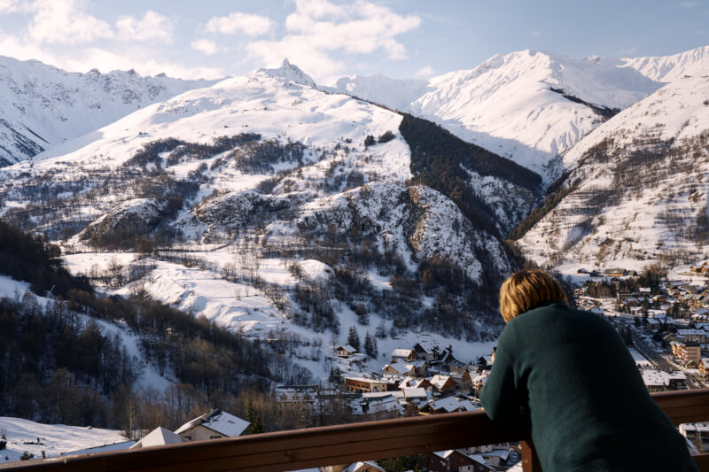
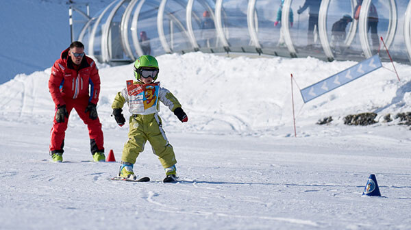
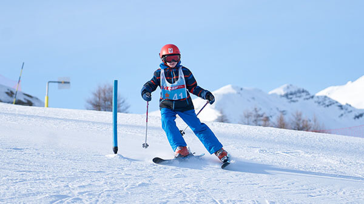
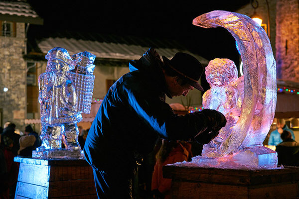
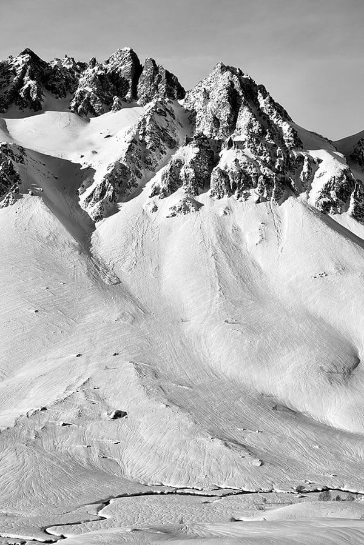

Imagine an exciting winter morning! Adrien, aged 9, has to be at his ski lesson by 9:15. At 8:50, you leave the apartment, put on your boots, and grab your skis. Head to the free ski bus stop, right at the foot of the chalets. By 9:10, you're at the ski area, at the base of the gondolas. Adrien goes off to ski with his group, and the rest of the family just has to hop on to hit the slopes, an epic day in the mountains ahead!



What makes [Valloire](https://www.valloire.net/en/) so special is that it combines the advantages of a family resort on a human scale, with those of a large domain equipped with 100 miles of ski slopes on 5 sides, with the latest ski lifts. And for those who are always seeking more, [Les 3 Vallées](https://www.les3vallees.com/en) are just a 35-minute drive away!

### Ski & Snowboard

The diversity of the [winter activities](https://www.valloire.net/en/profiter-de-valloire/le-ski/) is plethoric:

- For snowboarders, Snow Park at an altitude of 2300m.
- 6.2 miles of groomed [cross-country ski](https://www.valloire.net/en/profiter-de-valloire/le-ski/la-glisse-pour-tous/ski-de-fond/) trails.
- Two [ski schools (ESF and ESI)](https://www.valloire.net/en/profiter-de-valloire/le-ski/se-preparer-a-skier/apprendre-le-ski-a-valloire/) with 140 instructors and 3 kindergartens, as well as independent instructors.

And if all that wasn't enough, the departure of the [3 Vallées](https://www.les3vallees.com/en) cable car (Courchevel, Méribel, Les Ménuires, Val-Thorens, Orelle), the world's largest ski area with 600 km of slopes, open from November to May, is just 35 minutes away by car!

### Other activities

#### in the village

-  [Snake Gliss](https://www.valloire.net/en/sit/descente-en-snake-gliss-grande-aventure-388984/)
-  [Snowshoe](https://www.valloire.net/en/profiter-de-valloire/activites-outdoor/balades-a-pied-ou-en-raquettes-a-valloire/)
-  [Mountain Kart](https://www.valloire.net/en/actualites/descente-en-mountain-kart-lhiver-5413556/)
-  [Cross-country skiing](https://www.valloire.net/en/profiter-de-valloire/le-ski/la-glisse-pour-tous/ski-de-fond/)
-  [Ice Rink](https://www.valloire.net/en/famille-plus/patinoire-philippe-candeloro-93457/)
-  [Trail running](https://www.valloire.net/en/trail/le-trail-avec-rando-montagne-4620573/)
-  [Spa - Sens des Cimes](https://www.les-sens-des-cimes.com/)
-  [Spa & Gym - Val'Form](https://www.valloire.net/en/profiter-de-valloire/bien-etre/)
-  [Bowling, Billard & Arcade](https://www.valloire.net/en/sit/bowling-le-mafayo-371455/)
-  [and dozens of other activities!](https://www.valloire.net/en/profiter-de-valloire/)

#### less than an hour away

-  [Leisure park Valmigliss](https://www.valmigliss.com/copie-de-accueil-ete) (25mn)
-  [Orelle - Val Thorens - Les 3 Vallées](https://orelle.net/ski-resort/ski-area) (35mn)
-  [Espace Alu](https://espacealu.fr/english-tour.htm) (35mn)
-  [The Opinel Museum](https://www.opinel.com/en-fr/the-museum) (45mn)
-  [Norma Loops (4 Seasons Sled)](https://normaloops.fr/) (55mn)
-  and dozens of other activities!


Discover the flat
See availability

