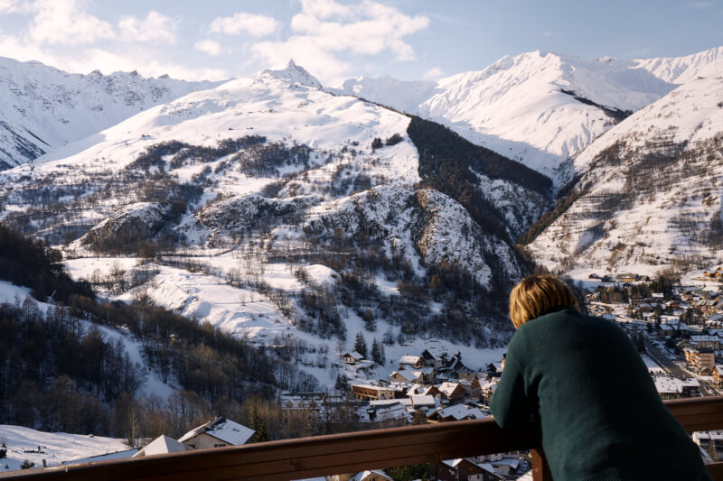
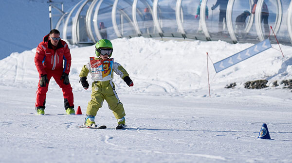
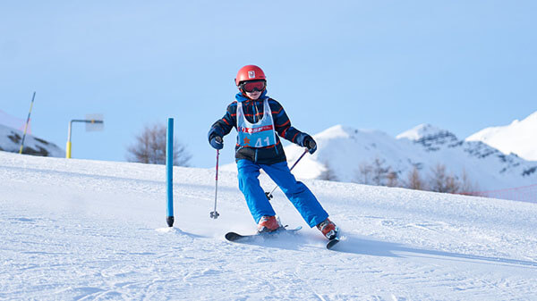
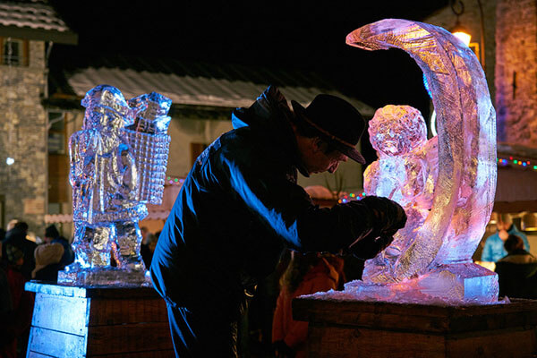
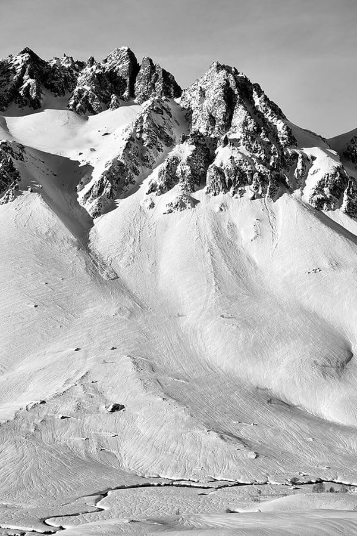

Imaginez une matinée d'hiver excitante ! Adrien, âgé de 9 ans, doit être à son cours de ski à 9h15. À 8h50, vous quittez l'appartement, enfilez vos bottes et prenez vos skis. Direction l'arrêt du skibus gratuit, juste au pied des châlets. À 9h10 vous êtes sur le front de neige, au pied des télécabines. Adrien part skier avec son groupe, et le reste de la famille n'a plus qu'à monter pour dévaler les pentes, une journée épique en montagne en perspective !

{{< map lazy=false src="https://www.google.com/maps/embed?pb=!1m28!1m12!1m3!1d1406.5786778195065!2d6.430923389162817!3d45.163663342767606!2m3!1f0!2f0!3f0!3m2!1i1024!2i768!4f13.1!4m13!3e2!4m5!1s0x478a21729eff66b1%3A0x13b9cd057ccf96bb!2sLe%20Col%20Roul%C3%A9%2C%20Route%20de%20l&#39;Archaz%2C%20Valloire!3m2!1d45.1631563!2d6.4344931999999995!4m5!1s0x478a210fef518a95%3A0x77a95ab4a7f3e4ea!2sESF%20-%20Ecole%20du%20ski%20fran%C3%A7ais%20de%20Valloire%2C%20Chemin%20du%20Cr%C3%AAt%20de%20la%20Brive%2C%20Valloire!3m2!1d45.164605599999994!2d6.4306722!5e0!3m2!1sen!2sfr!4v1713254024259!5m2!1sen!2sfr" >}}

[Valloire](https://www.valloire.net/) a cela de particulier qu'elle allie les avantages d'une station familiale à taille humaine et dynamique, et ceux d'un grand domaine équipé de 160km de pistes de ski sur 5 versants avec des remontées mécaniques dernier cri. Et pour les éternels insatisfaits, [Les 3 Vallées](https://www.les3vallees.com/fr) sont à seulement 35mn en voiture !

### Ski & Snowboard

La diversité des [activités d'hiver](https://www.valloire.net/profiter-de-valloire/le-ski/) est pléthorique :

- Pour les snowboarders, Snow Park à 2300m d'altitude.
- 10km de pistes de [ski de fond](https://www.valloire.net/profiter-de-valloire/le-ski/la-glisse-pour-tous/ski-de-fond/) aménagées.
- Deux [écoles de ski (ESF et ESI)](https://www.valloire.net/profiter-de-valloire/le-ski/se-preparer-a-skier/apprendre-le-ski-a-valloire/) comportant 140 moniteurs et 3 jardins d'enfants, ainsi que des moniteurs indépendants.

Et si tout cela ne vous suffisait pas, le départ de télécabine des [3 Vallées](https://www.les3vallees.com/fr) (Courchevel, Méribel, Les Ménuires, Val-Thorens, Orelle), le plus grand domaine skiable du monde avec ses 600 km de pistes, et ouvert de novembre à mai, est à seulement 35mn en voiture !

### Autres activités

#### sur place

-  [Snake Gliss](https://www.valloire.net/sit/descente-en-snake-gliss-grande-aventure-388984/)
-  [Balades en raquettes](https://www.valloire.net/profiter-de-valloire/activites-outdoor/balades-a-pied-ou-en-raquettes-a-valloire/)
-  [Mountain Kart](https://www.valloire.net/actualites/descente-en-mountain-kart-lhiver-5413556/)
-  [Ski de fond](https://www.valloire.net/profiter-de-valloire/le-ski/la-glisse-pour-tous/ski-de-fond/)
-  [Patinoire](https://www.valloire.net/famille-plus/patinoire-philippe-candeloro-93457/)
-  [Trail running](https://www.valloire.net/trail/le-trail-avec-rando-montagne-4620573/)
-  [Spa - Sens des Cimes](https://www.les-sens-des-cimes.com/)
-  [Spa & Gym - Val'Form](https://www.valloire.net/profiter-de-valloire/bien-etre/)
-  [Bowling, Billard & Arcade](https://www.valloire.net/sit/bowling-le-mafayo-371455/)
-  [et des dizaines d'autres activités !](https://www.valloire.net/profiter-de-valloire/)

#### à moins d'une heure

-  [Parc de loisirs Valmigliss](https://www.valmigliss.com/) (25mn)
-  [Orelle - Val Thorens - Les 3 Vallées](https://orelle.net/station-ski/domaine-skiable) (35mn)
-  [Espace Alu](https://espacealu.fr/Accueil.htm) (35mn)
-  [Musée Opinel](https://www.opinel.com/fr-fr/le-musee-opinel) (45mn)
-  [Norma Loops (Luge 4 Saisons)](https://normaloops.fr/) (55mn)
-  et des dizaines d'autres activités !


Découvrir l'appartement
Voir les disponibilités

