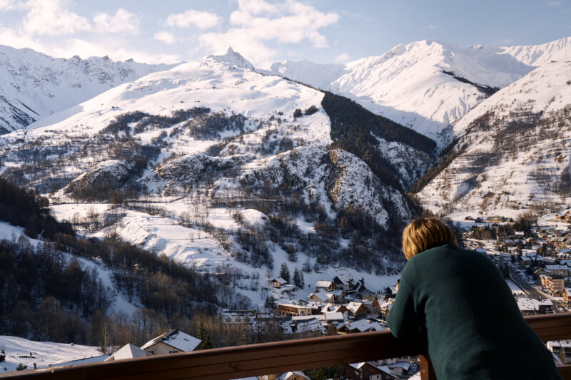
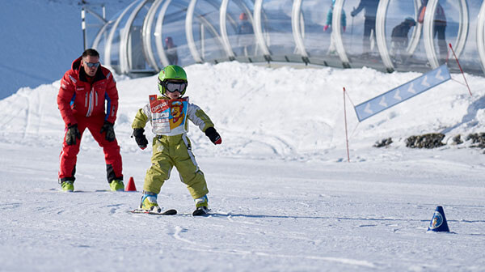
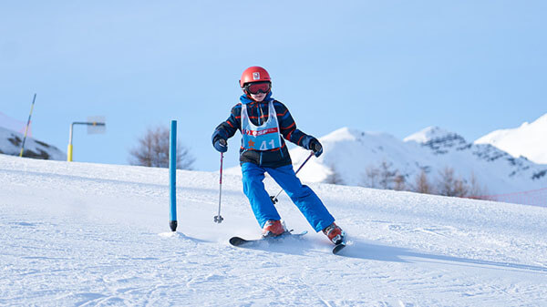
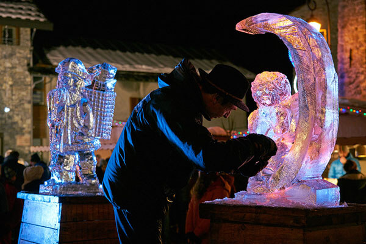
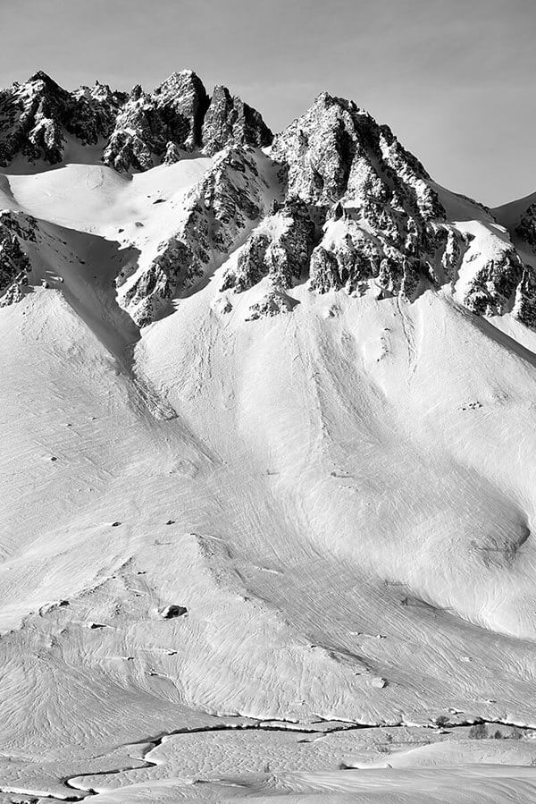

Immaginate un'emozionante mattina d'inverno! Adrien, 9 anni, deve essere alla lezione di sci alle 9:15. Alle 8:50 lasciate l'appartamento, infilate gli scarponi e prendete gli sci. Direzione la fermata dello skibus gratuito, proprio ai piedi degli chalet. Alle 9:10 siete ai piedi delle piste, alla partenza delle cabinovie. Adrien parte a sciare con il suo gruppo, e al resto della famiglia non resta che salire per sfrecciare lungo le piste: una giornata epica in montagna in prospettiva!



[Valloire](https://www.valloire.net/it/) ha la particolarità di unire i vantaggi di una stazione familiare, a misura di persona e dinamica, a quelli di un grande comprensorio con 160 km di piste su 5 versanti e impianti di risalita all'avanguardia. E per chi non si accontenta mai, [Les 3 Vallées](https://www.les3vallees.com/en) sono a soli 35 minuti in auto!

### Sci & Snowboard

La varietà di [attività invernali](https://www.valloire.net/it/profiter-de-valloire/le-ski/) è enorme:

- Per lo snowboard, uno snowpark a 2300 m di altitudine.
- 10 km di piste di [sci di fondo](https://www.valloire.net/it/profiter-de-valloire/le-ski/la-glisse-pour-tous/ski-de-fond/) battute.
- Due [scuole di sci (ESF ed ESI)](https://www.valloire.net/it/profiter-de-valloire/le-ski/se-preparer-a-skier/apprendre-le-ski-a-valloire/) con 140 tra maestre e maestri e 3 giardini della neve, oltre a lezioni private.

E se tutto questo non vi bastasse, la partenza della cabinovia per [Les 3 Vallées](https://www.les3vallees.com/en) (Courchevel, Méribel, Les Menuires, Val Thorens, Orelle), il più grande comprensorio sciistico del mondo con i suoi 600 km di piste, aperto da novembre a maggio, è a soli 35 minuti in auto!

### Altre attività

#### sul posto

-  [Snake Gliss](https://www.valloire.net/it/sit/descente-en-snake-gliss-grande-aventure-388984/)
-  [Ciaspolate](https://www.valloire.net/it/profiter-de-valloire/activites-outdoor/balades-a-pied-ou-en-raquettes-a-valloire/)
-  [Mountain Kart](https://www.valloire.net/it/actualites/descente-en-mountain-kart-lhiver-5413556/)
-  [Sci di fondo](https://www.valloire.net/it/profiter-de-valloire/le-ski/la-glisse-pour-tous/ski-de-fond/)
-  [Pista di pattinaggio](https://www.valloire.net/it/famille-plus/patinoire-philippe-candeloro-93457/)
-  [Trail running](https://www.valloire.net/it/trail/le-trail-avec-rando-montagne-4620573/)
-  [Spa - Sens des Cimes](https://www.les-sens-des-cimes.com/)
-  [Spa & Gym - Val'Form](https://www.valloire.net/it/profiter-de-valloire/bien-etre/)
-  [Bowling, biliardo & sala giochi](https://www.valloire.net/it/sit/bowling-le-mafayo-371455/)
-  [e decine di altre attività!](https://www.valloire.net/it/profiter-de-valloire/)

#### a meno di un'ora

-  [Parco divertimenti Valmigliss](https://www.valmigliss.com/copie-de-accueil-ete) (25 min)
-  [Orelle - Val Thorens - Les 3 Vallées](https://orelle.net/stazione-sciistica/compresorio-sciistico) (35 min)
-  [Espace Alu](https://espacealu.fr/Visita-in-italiano.htm) (35 min)
-  [Museo Opinel](https://www.opinel.com/it-int/il-museo) (45 min)
-  [Norma Loops (slittino 4 stagioni)](https://normaloops.fr/) (55 min)
-  e decine di altre attività!


Scopri l'appartamento
Vedi le disponibilità

