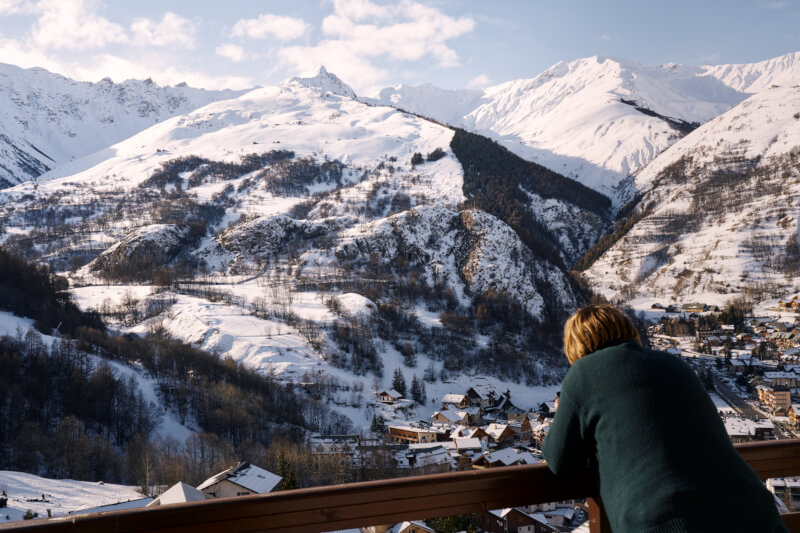
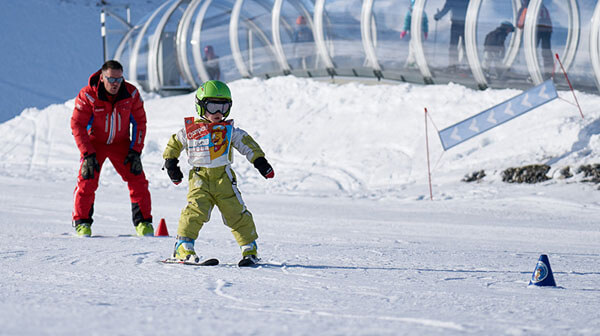
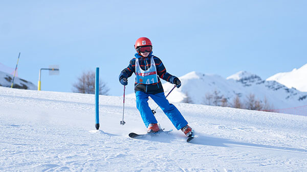
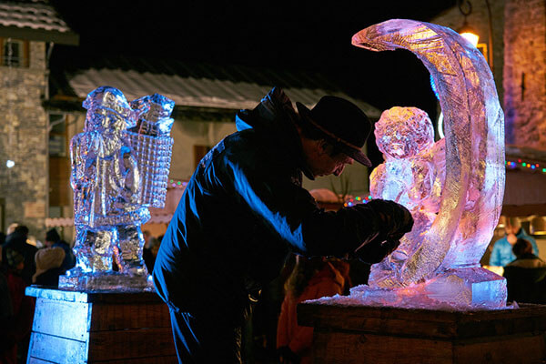
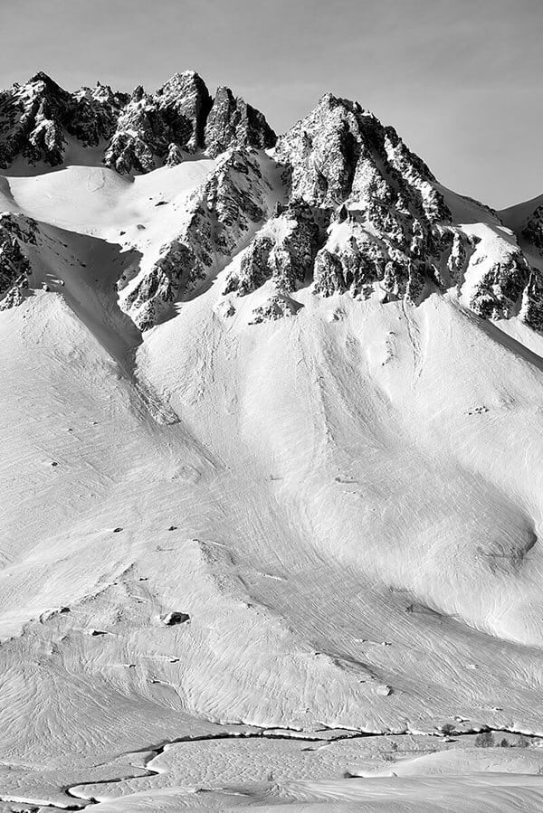

Stel u een spannende winterochtend voor! Adrien, 9 jaar, moet om 9u15 op skiles zijn. Om 8u50 verlaat u het appartement, trekt u uw skischoenen aan en neemt u uw ski's. Op naar de halte van de gratis skibus, vlak aan de voet van de chalets. Om 9u10 staat u aan de voet van de pistes, bij de gondels. Adrien vertrekt met zijn groep, en de rest van het gezin hoeft alleen nog naar boven om de hellingen af te suizen: een epische dag in de bergen in het vooruitzicht!



[Valloire](https://www.valloire.net/nl/) combineert de voordelen van een gezellig en dynamisch familiedorp met die van een groot skigebied met 160 km pistes op 5 berghellingen en ultramoderne skiliften. En voor wie nooit genoeg heeft: [Les 3 Vallées](https://www.les3vallees.com/en) liggen op amper 35 minuten met de auto!

### Ski & Snowboard

Het aanbod aan [winteractiviteiten](https://www.valloire.net/nl/profiter-de-valloire/le-ski/) is enorm:

- Voor snowboarders: een snowpark op 2300 m hoogte.
- 10 km aangelegde [langlaufpistes](https://www.valloire.net/nl/profiter-de-valloire/le-ski/la-glisse-pour-tous/ski-de-fond/).
- Twee [skischolen (ESF en ESI)](https://www.valloire.net/nl/profiter-de-valloire/le-ski/se-preparer-a-skier/apprendre-le-ski-a-valloire/) met 140 skileraren en 3 kindertuinen, en daarnaast zelfstandige skileraren.

En is dat allemaal nog niet genoeg: het vertrekpunt van de gondel naar [Les 3 Vallées](https://www.les3vallees.com/en) (Courchevel, Méribel, Les Menuires, Val Thorens, Orelle), het grootste skigebied ter wereld met 600 km pistes, open van november tot mei, ligt op amper 35 minuten met de auto!

### Andere activiteiten

#### ter plaatse

-  [Snake Gliss](https://www.valloire.net/nl/sit/descente-en-snake-gliss-grande-aventure-388984/)
-  [Sneeuwschoenwandelingen](https://www.valloire.net/nl/profiter-de-valloire/activites-outdoor/balades-a-pied-ou-en-raquettes-a-valloire/)
-  [Mountain Kart](https://www.valloire.net/nl/actualites/descente-en-mountain-kart-lhiver-5413556/)
-  [Langlaufen](https://www.valloire.net/nl/profiter-de-valloire/le-ski/la-glisse-pour-tous/ski-de-fond/)
-  [Schaatsbaan](https://www.valloire.net/nl/famille-plus/patinoire-philippe-candeloro-93457/)
-  [Trailrunning](https://www.valloire.net/nl/trail/le-trail-avec-rando-montagne-4620573/)
-  [Spa - Sens des Cimes](https://www.les-sens-des-cimes.com/)
-  [Spa & Gym - Val'Form](https://www.valloire.net/nl/profiter-de-valloire/bien-etre/)
-  [Bowling, biljart & arcade](https://www.valloire.net/nl/sit/bowling-le-mafayo-371455/)
-  [en tientallen andere activiteiten!](https://www.valloire.net/nl/profiter-de-valloire/)

#### op minder dan een uur

-  [Vrijetijdspark Valmigliss](https://www.valmigliss.com/copie-de-accueil-ete) (25 min)
-  [Orelle - Val Thorens - Les 3 Vallées](https://orelle.net/ski-resort/ski-area) (35 min)
-  [Espace Alu](https://espacealu.fr/english-tour.htm) (35 min)
-  [Opinel-museum](https://www.opinel.com/nl-int/het-museum) (45 min)
-  [Norma Loops (rodelbaan, 4 seizoenen)](https://normaloops.fr/) (55 min)
-  en tientallen andere activiteiten!


Ontdek het appartement
Bekijk de beschikbaarheid

