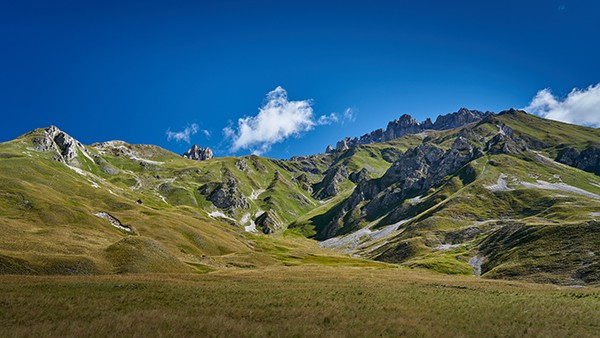

Im Sommer liegt [unsere Wohnung](/apartment) ideal, 10 Gehminuten ([idyllischer Wanderweg](/shops), 15 Minuten bergauf) vom Zentrum von Valloire, den Geschäften und Aktivitäten sowie der Gondelbahn Crêt de la Brive (im Sommer für Fussgänger und Mountainbikes geöffnet) und 18-20 Gehminuten vom Freizeitzentrum (Schwimmbad, Eisbahn, Wellness) entfernt. Bei Bedarf ist natürlich alles auch mit dem Auto erreichbar (2 private Parkplätze im Mietpreis inbegriffen, dazu eine eigene 7-kW-Ladestation, T2S + TE, für Elektroautos).

Das Tüpfelchen auf dem i: Unsere grosse überdachte Terrasse von 20 m² bietet Ihnen genug Platz, um Ihre Ausrüstung zu verstauen!



Ob Sie mit dem Rad Pässe erklimmen, mit dem Mountainbike oder Kart die Hänge hinuntersausen, Tageswanderungen, Hüttentouren oder Biwaks unternehmen, Felswände kletternd oder am Klettersteig bezwingen, mit dem Gleitschirm oder Ultraleichtflugzeug abheben oder sich einfach auf dem Golfplatz, im Schwimmbad oder im Spa entspannen möchten: In Valloire finden Sie bestimmt Ihr Glück.

### Radfahren

Valloire liegt zwischen dem Col du Télégraphe und dem Col du Galibier, nördlich des Col du Lautaret, die durch [die Tour de France](https://www.letour.fr/de/) berühmt wurden, mitten im Maurienne-Tal, das sich als grösstes Radsportgebiet der Welt bezeichnet. Radfahrer, ob Amateure oder Profis, kommen hier voll auf ihre Kosten, auf dem Rennrad oder dem E-Bike (vor Ort zu mieten)!

Auch Mountainbiker kommen nicht zu kurz. Valloire ist ein Paradies für Mountainbiker... 155 km markierte Strecken aller Schwierigkeitsgrade und 1 Bikepark (an der Bergstation der Gondelbahn Crêt de la Brive). In wenigen Minuten bringt Sie die Gondelbahn auf 2100 m Höhe, zu Abfahrten verschiedener Schwierigkeitsgrade, darunter eine 9 km lange Familienstrecke, die sich zwischen Alpweiden und Wäldern schlängelt.

Im Dorf begeistert ein 240 m langer Pumptrack mit 3 Niveaus die Fans dieser Disziplin, ob mit dem Rad oder dem Trottinett. Er ist frei zugänglich und liegt gleich neben dem Skatepark und der Eisbahn.

 Valloire.net")


Mehr Infos


### Wandern

Valloire wird von seinen Bewohnern das Goldene Tal genannt, wegen seiner aussergewöhnlich vielen Sonnenstunden, die den Südalpen auf der anderen Seite des Col du Galibier in nichts nachstehen. Die 14'000 Hektar Hochgebirge rund um den Mont Thabor und die Aiguilles d'Arves beherbergen eine unberührte Tier- und Pflanzenwelt, die Ihre Lust auf Natur stillen wird. Und falls Sie nach einigen Aufenthalten in unserem Tal einmal das Tal wechseln möchten: Nur 45 Autominuten entfernt bieten Ihnen die Meije und die Écrins neue Gebiete zum Entdecken.


Mehr Infos


### Klettern

Meist mitten im Dorf erfüllen 3 Klettersteige und Hunderte von Kletterrouten alle Wünsche. Mehrere Geschäfte vermieten die Ausrüstung, und das Bureau des Guides begleitet Sie bei Bedarf.

 Valloire.net")


Mehr Infos


### Weitere Aktivitäten

#### vor Ort

-  [Eisbahn](https://www.valloire.net/en/famille-plus/patinoire-philippe-candeloro-93457/)
-  [Beheiztes Freibad mit Rutsche](https://www.valloire.net/en/activites-aquatiques/piscine-de-valloire-371454/)
-  [Reitzentrum](https://www.valloire.net/en/sit/centre-equestre-de-valloire-prejvall-371453/)
-  [Tennis](https://www.valloire.net/en/sit/court-de-tennis-a-louer-371460/)
-  [Seilpark](https://www.valloire.net/en/sit/la-foret-de-lenfer-parc-accrobranche-68131/)
-  [3 Ziplines, darunter eine Riesen-Zipline](https://www.valloire.net/en/profiter-de-valloire/activites-outdoor/sur-les-hauteurs/)
-  [Bob-Kart](https://www.valloire.net/en/sit/activite-bob-kart-371390/) und [Mountain Cart](https://www.valloire.net/en/sit/descente-en-mountain-kart-lete-6971906/)
-  [Mountainboard](https://www.valloire.net/en/sit/lecole-francaise-de-mountainboard-glisse-ete-371392/)
-  [Canyoning](https://www.valloire.net/en/activites-aquatiques/sorties-canyoning-avec-benexpe-5504504/)
-  [Bogenschiessen](https://www.valloire.net/en/sit/tir-a-larc-590455/)
-  [Besichtigung des Fort du Télégraphe](https://www.valloire.net/en/sit/le-fort-du-telegraphe-436553/)
-  [Elektro-Mountainbikes](https://www.valloire.net/en/profiter-de-valloire/activites-outdoor/le-velo/le-vae-a-valloire/)
-  [Gleitschirm, Speedriding & Ultraleichtflug](https://www.valloire.net/en/profiter-de-valloire/activites-outdoor/dans-les-airs/)
-  [Fliegerclub](https://www.aeroclub-de-valloire.com/)
-  [Golf](https://www.valloire.net/en/sit/golf-des-verneys-371458/)
-  [Fischen](https://www.valloire.net/en/profiter-de-valloire/activites-outdoor/les-pieds-dans-leau/)
-  [Trailrunning](https://www.valloire.net/en/profiter-de-valloire/activites-outdoor/la-randonnee/le-trail-a-valloire/)
-  [Spa - Sens des Cimes](https://www.les-sens-des-cimes.com/)
-  [Spa & Gym - Val'Form](https://www.valloire.net/en/profiter-de-valloire/bien-etre/)
-  [Bowling, Billard & Arcade](https://www.valloire.net/en/sit/bowling-le-mafayo-371455/)
-  [und Dutzende weitere Aktivitäten!](https://www.valloire.net/en/profiter-de-valloire/)

#### in weniger als einer Stunde

-  [Freizeitpark Valmigliss](https://www.valmigliss.com/copie-de-accueil-ete) (25 Min.)
-  [Thermalbad Le Monêtier-les-Bains](https://lesgrandsbainsdumonetier.fr/en) (55 Min.)
-  [Espace Alu](https://espacealu.fr/Besuch-auf-Deutsch.htm) (35 Min.)
-  [Opinel-Museum](https://www.opinel.com/de-int/das-museum) (45 Min.)
-  [Norma Loops (Rodelbahn, 4 Jahreszeiten)](https://normaloops.fr/) (55 Min.)
-  [Parcobranche du Diable (Seilpark, Riesen-Ziplines)](https://www.parcdudiable.fr/) (55 Min.)
-  [St Alban Plage](https://plage-lac-aiguebelette.com/) und [Lac des Hurtières](https://www.google.com/maps/search/?api=1&query=Lac+des+Hurti%C3%A8res) (1 Std.)
-  und Dutzende weitere Aktivitäten!

#### in weniger als zwei Stunden

-  [Wam Park Savoie - Montailleur (Wasserskilift, Wakeboard, Seilpark, Wasserspiele, ...)](https://www.wampark.fr/base/savoie-montailleur/) (1 Std. 15)
-  [Rafting Serre Chevalier](https://www.youraft-serrechevalier.com/en/) (1 Std. 25)
-  [Elektro-Mountainbikes](https://serre-chevalier.bike/) (1 Std. 40)
-  [Riesen-Zipline - Serre Chevalier](https://www.serre-chevalier.com/en/altitude-area/giant-zipline-summer) (2 Std.)
-  und Dutzende weitere Aktivitäten!


Die Wohnung entdecken
Verfügbarkeit ansehen

