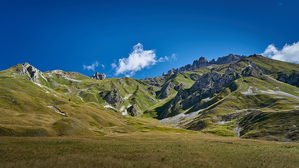

In the summer, [our flat](/apartment) is perfectly positioned, just a 10-minute walk downhill (15 minutes back up) along a [scenic hiking trail](https://www.viewgpx.com/route/bMjNJt5p) from the center of Valloire, its shops, activities, and the Crêt de la Brive gondolas (operational in summer for pedestrians and mountain bikers). Additionally, it's an 18-20 minute walk from the leisure center, which includes a swimming pool, ice rink, and wellness area. If needed, you can always opt for the convenience of your car (2 private parking spaces are included with the rental, complemented by a 7 kW T2S + TE private charging point for electric vehicles).

And to top it off, our generous 215 sqft covered terrace provides ample room for storing your equipment!



Whether you're here to conquer mountain passes on your bike, descend thrilling mountain biking trails, enjoy a day of hiking, experience refuge or bivouac stays, scale cliffs through climbing or via ferrata, take to the skies with paragliding or ultralight flying, or simply unwind on the golf course, by the pool, or at the spa, Valloire has something tailor-made for you.

### Cycling

Valloire is situated between the Col du Télégraphe and the Col du Galibier, north of the Col du Lautaret, made famous by the [Tour de France](https://www.letour.fr/en/), in the heart of the Maurienne valley which claims to be the largest cycling area in the world. Cyclists, amateurs or professionals will be able to satisfy their cycling desires, whether regular or electric (available for hire on site)!

Mountain bike enthusiasts will not be outdone. Valloire is a paradise for mountain bikers... 100 miles of marked trails for all levels and 1 bike park (at the arrival of the Crêt de la Brive cable car). In just a few minutes the gondola takes you up to 2100m altitude to access different levels of descent, including a 5.5 miles family trail that winds between mountain pastures and forests.

In the village, a 260 yards Pump Track divided into 3 levels will also delight fans of the discipline, whether on a bike or a scooter. With free access, it is located right next to the Skate Park and the Ice Rink.

 Valloire.net")


More information


### Hiking

Valloire is nicknamed La Vallée d'Or by its inhabitants because of its exceptional sunshine which has nothing to envy to the Southern Alps, on the other side of the Col du Galibier. The 35,000 acres of high mountains around Mont Thabor and the Aiguilles d'Arves are home to a preserved fauna and flora that will satisfy your desire for nature. And if after several stays in our valley you would like to change valley, only 45 minutes by car the Meije and the Ecrins will offer you new territories to discover.


More information


### Climbing

For the most part in the village, 3 via ferrata and hundreds of climbing routes will satisfy all desires. Several shops rent the material, and the Guide Bureau will be able to accompany you if necessary.

 Valloire.net")


More information


### Other activities

#### in the village

-  [Ice rink](https://www.valloire.net/en/famille-plus/patinoire-philippe-candeloro-93457/)
-  [Heated outdoor swimming pool with slide](https://www.valloire.net/en/activites-aquatiques/piscine-de-valloire-371454/)
-  [Horse riding centre](https://www.valloire.net/en/sit/centre-equestre-de-valloire-prejvall-371453/)
-  [Tennis](https://www.valloire.net/en/sit/court-de-tennis-a-louer-371460/)
-  [Branch hook](https://www.valloire.net/en/sit/la-foret-de-lenfer-parc-accrobranche-68131/)
-  [3 zip lines, including a giant one](https://www.valloire.net/en/profiter-de-valloire/activites-outdoor/sur-les-hauteurs/)
-  [Bob-Kart](https://www.valloire.net/en/sit/activite-bob-kart-371390/) and [Mountain Cart](https://www.valloire.net/en/sit/descente-en-mountain-kart-lete-6971906/)
-  [Mountainboard](https://www.valloire.net/en/sit/lecole-francaise-de-mountainboard-glisse-ete-371392/)
-  [Canyoning](https://www.valloire.net/en/activites-aquatiques/sorties-canyoning-avec-benexpe-5504504/)
-  [Archery](https://www.valloire.net/en/sit/tir-a-larc-590455/)
-  [Visit of the Telegraph Fort](https://www.valloire.net/en/sit/le-fort-du-telegraphe-436553/)
-  [Electric VTT / MTB](https://www.valloire.net/en/profiter-de-valloire/activites-outdoor/le-velo/le-vae-a-valloire/)
-  [Paragliding, speed-riding & ultralights](https://www.valloire.net/en/profiter-de-valloire/activites-outdoor/dans-les-airs/)
-  [Aeroclub](https://www.aeroclub-de-valloire.com/)
-  [Golf](https://www.valloire.net/en/sit/golf-des-verneys-371458/)
-  [Fishing](https://www.valloire.net/en/profiter-de-valloire/activites-outdoor/les-pieds-dans-leau/)
-  [Trail running](https://www.valloire.net/en/profiter-de-valloire/activites-outdoor/la-randonnee/le-trail-a-valloire/)
-  [Spa - Sens des Cimes](https://www.les-sens-des-cimes.com/)
-  [Spa & Gym - Val'Form](https://www.valloire.net/en/profiter-de-valloire/bien-etre/)
-  [Bowling, Billard & Arcade](https://www.valloire.net/en/sit/bowling-le-mafayo-371455/)
-  [and dozens of other activities!](https://www.valloire.net/en/profiter-de-valloire/)

#### less than an hour away

-  [Leisure park Valmigliss](https://www.valmigliss.com/copie-de-accueil-ete) (25mn)
-  [Thermal baths of Monêtier-les-Bains](https://lesgrandsbainsdumonetier.fr/en) (55mn)
-  [Espace Alu](https://espacealu.fr/english-tour.htm) (35mn)
-  [The Opinel Museum](https://www.opinel.com/en-fr/the-museum) (45mn)
-  [Norma Loops (4 Seasons Sled)](https://normaloops.fr/) (55mn)
-  [Parcobranche du Diable (Branch hook, Giant Ziplines)](https://www.parcdudiable.fr/) (55mn)
-  [St Alban Beach](https://plage-lac-aiguebelette.com/) and [Hurtières Lake](https://www.google.com/maps/search/?api=1&query=Lac+des+Hurti%C3%A8res) (1h)
-  and dozens of other activities!

#### less than two hours away

-  [Wam Park Savoie - Montailleur (Teleski, Wakeboard, Tree climbing, Water games, ...)](https://www.wampark.fr/base/savoie-montailleur/) (1h15)
-  [EXO 73 (Teleski, Wakeboard, ...)](https://www.exoloisirs.com/en/content/exo-73-tns-73) (1h15)
-  [Rafting Serre Chevalier](https://www.youraft-serrechevalier.com/en/) (1h25)
-  [Electric VTT / MTB](https://serre-chevalier.bike/) (1h40)
-  [Giant Zipline - Serre Chevalier](https://www.serre-chevalier.com/en/altitude-area/giant-zipline-summer) (2h)
-  and dozens of other activities!


Discover the flat
See availability

