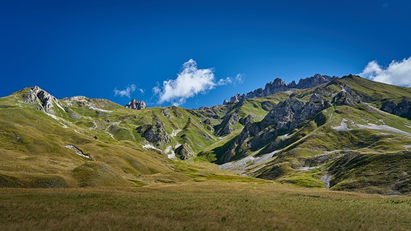

En été [notre appartement](/apartment) est idéalement situé à 10mn à pied ([chemin de petite randonnée bucolique](https://www.viewgpx.com/route/bMjNJt5p), 15mn en remontée) du centre de Valloire, des commerces et activités, et de la télécabine du Crêt de la Brive (ouverte en été pour les piétons et les VTT), et à 18-20mn à pied de la base de loisirs (piscine, patinoire, espace bien-être). Si besoin, tout est bien entendu faisable en voiture (2 places de parking privées incluses dans la location, avec en prime une borne de charge VE privative 7 kW T2S + TE pour véhicule électriques).

Cerise sur le gâteau, notre grande terrasse abritée de 20m² vous offre toute la place nécessaire pour ranger votre matériel !



Que vous veniez pour gravir les cols à vélo, dévaler les pentes en VTT ou en kart, faire de la randonnée à la journée, en refuge ou en bivouac, parcourir les falaises en escalade ou en via ferrata, prendre l'air en parapente ou en ulm, ou tout simplement vous détendre sur le golf, à la piscine ou au spa, vous trouverez forcément votre bonheur à Valloire.

### Cyclisme

Valloire est située entre le col du Télégraphe et le Col du Galibier, au nord du Col du Lautaret, rendus célèbres par [Le Tour de France](https://www.letour.fr/fr/), en plein coeur de la vallée de la Maurienne qui se revendique comme le plus grand domaine cyclable du monde. Les cyclistes, amateurs ou professionnels pourront assouvir leurs envies de vélo, qu'il soit de route ou électrique (VAE, en location sur place) !

Les amateurs de VTT ne seront pas en reste. Valloire est un paradis pour les VTTistes… 155 km de parcours balisés de tous niveaux et 1 bike park (à l'arrivée de la télécabine du Crêt de la Brive). En quelques minutes la télécabine vous achemine en effet à 2100m d'altitude pour accéder à différents niveaux de descente dont une piste familiale de 9 km qui serpente entre alpages et forêts.

Dans le village, une Pump Track de 240m répartis en 3 niveaux ravira aussi les adeptes de la discipline, que ce soit en vélo ou en trotinette. En accès libre, elle est située juste à coté du Skate Parc et de la Patinoire.

 Valloire.net")


Plus d'infos


### Randonnées

Valloire est surnommée La Vallée d'Or par ses habitants du fait de son ensoleillement exceptionnel qui n'a rien à envier aux Alpes du Sud, de l'autre coté du Col du Galibier. Les 14,000 hectares de haute montagne autour du Mont Thabor et des Aiguilles d'Arves hébergent une faune et une flore préservées qui sauront assouvir vos envies de nature. Et si jamais après plusieurs séjours dans notre vallée vous vouliez changer de vallée, à seulement 45mn en voiture la Meije et les Ecrins vous offriront de nouveaux territoires à découvrir.


Plus d'infos


### Escalade

Pour la plupart en plein village, 3 via ferrata et des centaines de voies d'escalades sauront répondre à toutes les envies. Plusieurs magasins louent le materiel, et le Bureau des Guides saura vous accompagner si besoin.

 Valloire.net")


Plus d'infos


### Autres activités

#### sur place

-  [Patinoire](https://www.valloire.net/equipement/patinoire-philippe-candeloro-valloire/)
-  [Piscine exterieure chauffée avec toboggan](https://www.valloire.net/equipement/piscine-de-valloire-valloire/)
-  [Centre équestre](https://goo.gl/maps/mDiDbKPrjS5ecnMt6)
-  [Tennis](https://www.valloire.net/equipement/tennis-valloire/)
-  [Accrobranche](https://www.valloire.net/activite/la-foret-de-lenfer-parc-accrobranche-valloire/)
-  [3 tyroliennes, dont une géante](https://www.valloire.net/quoi-faire/activites-sportives-et-de-loisirs/plein-air/)
-  [Bob-Kart](https://www.valloire.net/activite/bob-kart-valloire/) et [Mountain Cart](https://www.valloire.net/activite/mountain-kart-valloire/)
-  [Mountainboard](https://www.valloire.net/activite/lecole-francaise-de-mountainboard-valloire-2/)
-  [Canyoning](https://www.valloire.net/activite/canyoning-avec-ben-expe-valloire/)
-  [Tir à l'arc](https://www.valloire.net/equipement/tir-a-larc-valloire/)
-  [Visite du Fort du Télégraphe](https://www.valloire.net/patrimoine-culturel/le-fort-du-telegraphe-valloire/)
-  [VTT / MTB électriques](https://www.valloire.net/quoi-faire/le-velo/le-vae/)
-  [Parapente, Speed-riding & ULM](https://www.valloire.net/quoi-faire/activites-sportives-et-de-loisirs/aerien/)
-  [Aéroclub](https://www.aeroclub-de-valloire.com/)
-  [Golf](https://www.valloire.net/equipement/golf-des-verneys-valloire/)
-  [Pêche](https://www.valloire.net/quoi-faire/activites-sportives-et-de-loisirs/aquatique/)
-  [Trail running](https://www.valloire.net/quoi-faire/activites-sportives-et-de-loisirs/trail/)
-  [Spa - Sens des Cimes](https://www.les-sens-des-cimes.com/)
-  [Spa & Gym - Val'Form](https://www.valloire.net/equipement/valform-centre-bien-etre-et-remise-en-forme-valloire/)
-  [Bowling, Billard & Arcade](https://www.valloire.net/equipement/bowling-le-mafayo-valloire/)
-  [et des dizaines d'autres activités !](https://www.valloire.net/quoi-faire/)

#### à moins d'une heure

-  [Parc de loisirs Valmigliss](https://www.valmigliss.com/) (25mn)
-  [Thermes du Monêtier-les-Bains](https://lesgrandsbainsdumonetier.fr/) (55mn)
-  [Espace Alu](https://espacealu.fr/) (35mn)
-  [Musée Opinel](https://www.opinel.com/la-marque/le-musee-opinel) (45mn)
-  [Norma Loops (Luge 4 Saisons)](https://normaloops.fr/) (55mn)
-  [Parcobranche du Diable (Accrobranche, Tyroliennes géantes)](http://www.parcdudiable.fr/) (55mn)
-  [St Alban Plage](http://plage-lac-aiguebelette.com/) et [Lac des Hurtières](http://www.cchautemaurienne.com/plan-deau-des-hurtieres) (1h)
-  et des dizaines d'autres activités !

#### à moins de deux heures

-  [Wam Park (Teleski, Wakeboard, Accrobranche, Water games, ...)](https://www.wampark.fr/albertville-savoie/) (1h15)
-  [EXO 73 (Teleski, Wakeboard, ...)](https://www.anjouwakepark.com/fr/content/exo-73-tns-73-0) (1h15)
-  [Rafting Serre Chevalier](https://www.youraft-serrechevalier.com/) (1h25)
-  [VTT / MTB électriques](https://serre-chevalier.bike/) (1h40)
-  [Tyrolienne géante - Serre Chevalier](https://www.serre-chevalier.com/fr/domaine-altitude/tyrolienne-geante-ete) (2h)
-  et des dizaines d'autres activités !


Découvrir l'appartement
Voir les disponibilités

