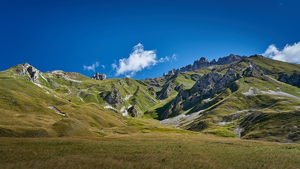

In estate [il nostro appartamento](/apartment) si trova in posizione ideale, a 10 minuti a piedi ([sentiero bucolico](/shops), 15 minuti in salita) dal centro di Valloire, dai negozi e dalle attività, e dalla cabinovia del Crêt de la Brive (aperta in estate per pedoni e mountain bike), e a 18-20 minuti a piedi dal centro ricreativo (piscina, pista di pattinaggio, centro benessere). Se necessario, tutto è ovviamente raggiungibile anche in auto (2 posti auto privati inclusi nell'affitto, con in più una colonnina di ricarica privata da 7 kW, T2S + TE, per auto elettriche).

La ciliegina sulla torta: la nostra grande terrazza coperta di 20 m² vi offre tutto lo spazio necessario per riporre la vostra attrezzatura!



Che veniate per scalare i colli in bici, scendere a tutta velocità in mountain bike o in kart, fare escursioni in giornata, in rifugio o in bivacco, percorrere le pareti arrampicando o in via ferrata, prendere il volo in parapendio o in ultraleggero, o semplicemente rilassarvi al golf, in piscina o alla spa, a Valloire troverete sicuramente quello che fa per voi.

### Ciclismo

Valloire si trova tra il Col du Télégraphe e il Col du Galibier, a nord del Col du Lautaret, resi celebri dal [Tour de France](https://www.letour.fr/en/), nel cuore della valle della Maurienne, che si definisce il più grande comprensorio ciclistico del mondo. I ciclisti, amatori o professionisti, potranno soddisfare la loro voglia di bici, da strada o elettrica (e-bike a noleggio sul posto)!

Anche gli appassionati di mountain bike saranno accontentati. Valloire è un paradiso per i biker... 155 km di percorsi segnalati di tutti i livelli e 1 bike park (all'arrivo della cabinovia del Crêt de la Brive). In pochi minuti la cabinovia vi porta infatti a 2100 m di altitudine, verso discese di vari livelli, tra cui un percorso per famiglie di 9 km che si snoda tra alpeggi e boschi.

In paese, una pump track di 240 m su 3 livelli farà la gioia degli appassionati della disciplina, in bici o in monopattino. Ad accesso libero, si trova proprio accanto allo skate park e alla pista di pattinaggio.

 Valloire.net")


Maggiori informazioni


### Escursioni

Valloire è soprannominata dai suoi abitanti la Valle d'Oro per il suo soleggiamento eccezionale, che non ha nulla da invidiare alle Alpi del Sud, dall'altra parte del Col du Galibier. I 14.000 ettari di alta montagna intorno al Mont Thabor e alle Aiguilles d'Arves ospitano una fauna e una flora preservate che sapranno soddisfare la vostra voglia di natura. E se dopo qualche soggiorno nella nostra valle voleste cambiare valle, a soli 45 minuti in auto la Meije e gli Écrins vi offriranno nuovi territori da scoprire.


Maggiori informazioni


### Arrampicata

Per lo più in pieno paese, 3 vie ferrate e centinaia di vie di arrampicata sapranno soddisfare ogni desiderio. Diversi negozi noleggiano l'attrezzatura, e il Bureau des Guides potrà accompagnarvi se necessario.

 Valloire.net")


Maggiori informazioni


### Altre attività

#### sul posto

-  [Pista di pattinaggio](https://www.valloire.net/it/famille-plus/patinoire-philippe-candeloro-93457/)
-  [Piscina all'aperto riscaldata con scivolo](https://www.valloire.net/it/activites-aquatiques/piscine-de-valloire-371454/)
-  [Centro equestre](https://www.valloire.net/it/sit/centre-equestre-de-valloire-prejvall-371453/)
-  [Tennis](https://www.valloire.net/it/sit/court-de-tennis-a-louer-371460/)
-  [Parco avventura](https://www.valloire.net/it/sit/la-foret-de-lenfer-parc-accrobranche-68131/)
-  [3 zipline, di cui una gigante](https://www.valloire.net/it/profiter-de-valloire/activites-outdoor/sur-les-hauteurs/)
-  [Bob-Kart](https://www.valloire.net/it/sit/activite-bob-kart-371390/) e [Mountain Cart](https://www.valloire.net/it/sit/descente-en-mountain-kart-lete-6971906/)
-  [Mountainboard](https://www.valloire.net/it/sit/lecole-francaise-de-mountainboard-glisse-ete-371392/)
-  [Canyoning](https://www.valloire.net/it/activites-aquatiques/sorties-canyoning-avec-benexpe-5504504/)
-  [Tiro con l'arco](https://www.valloire.net/it/sit/tir-a-larc-590455/)
-  [Visita del Fort du Télégraphe](https://www.valloire.net/it/sit/le-fort-du-telegraphe-436553/)
-  [Mountain bike elettriche](https://www.valloire.net/it/profiter-de-valloire/activites-outdoor/le-velo/le-vae-a-valloire/)
-  [Parapendio, speed riding & ultraleggero](https://www.valloire.net/it/profiter-de-valloire/activites-outdoor/dans-les-airs/)
-  [Aeroclub](https://www.aeroclub-de-valloire.com/)
-  [Golf](https://www.valloire.net/it/sit/golf-des-verneys-371458/)
-  [Pesca](https://www.valloire.net/it/profiter-de-valloire/activites-outdoor/les-pieds-dans-leau/)
-  [Trail running](https://www.valloire.net/it/profiter-de-valloire/activites-outdoor/la-randonnee/le-trail-a-valloire/)
-  [Spa - Sens des Cimes](https://www.les-sens-des-cimes.com/)
-  [Spa & Gym - Val'Form](https://www.valloire.net/it/profiter-de-valloire/bien-etre/)
-  [Bowling, biliardo & sala giochi](https://www.valloire.net/it/sit/bowling-le-mafayo-371455/)
-  [e decine di altre attività!](https://www.valloire.net/it/profiter-de-valloire/)

#### a meno di un'ora

-  [Parco divertimenti Valmigliss](https://www.valmigliss.com/copie-de-accueil-ete) (25 min)
-  [Terme di Le Monêtier-les-Bains](https://lesgrandsbainsdumonetier.fr/it) (55 min)
-  [Espace Alu](https://espacealu.fr/Visita-in-italiano.htm) (35 min)
-  [Museo Opinel](https://www.opinel.com/it-int/il-museo) (45 min)
-  [Norma Loops (slittino 4 stagioni)](https://normaloops.fr/) (55 min)
-  [Parcobranche du Diable (parco avventura, zipline giganti)](https://www.parcdudiable.fr/) (55 min)
-  [St Alban Plage](https://plage-lac-aiguebelette.com/) e [Lac des Hurtières](https://www.google.com/maps/search/?api=1&query=Lac+des+Hurti%C3%A8res) (1 h)
-  e decine di altre attività!

#### a meno di due ore

-  [Wam Park Savoie - Montailleur (sci nautico a fune, wakeboard, parco avventura, giochi d'acqua, ...)](https://www.wampark.fr/base/savoie-montailleur/) (1 h 15)
-  [Rafting Serre Chevalier](https://www.serre-chevalier.com/it/rafting-5216501) (1 h 25)
-  [Mountain bike elettriche](https://serre-chevalier.bike/) (1 h 40)
-  [Zipline gigante - Serre Chevalier](https://www.serre-chevalier.com/it/dominio-altitudine/tyrolienne-geante) (2 h)
-  e decine di altre attività!


Scopri l'appartamento
Vedi le disponibilità

