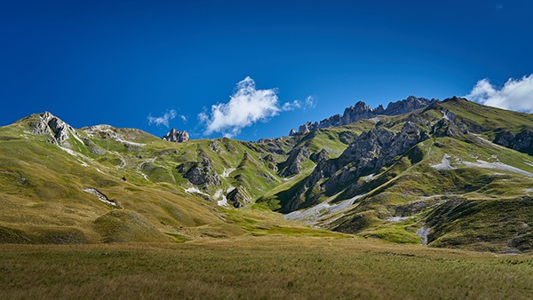

In de zomer ligt [ons appartement](/apartment) ideaal op 10 minuten wandelen ([idyllisch wandelpad](https://www.viewgpx.com/route/bMjNJt5p), 15 minuten bergop) van het centrum van Valloire, de winkels en activiteiten, en de gondel van de Crêt de la Brive (in de zomer open voor wandelaars en mountainbikes), en op 18-20 minuten wandelen van het recreatiecentrum (zwembad, schaatsbaan, wellness). Indien nodig kan alles uiteraard ook met de auto (2 privéparkeerplaatsen inbegrepen in de huur, met als extraatje een eigen laadpaal van 7 kW, T2S + TE, voor elektrische wagens).

Kers op de taart: ons groot overdekt terras van 20 m² biedt u alle plaats om uw materiaal op te bergen!



Of u nu komt om cols te beklimmen per fiets, hellingen af te razen per mountainbike of kart, dagtochten te wandelen, met overnachting in een berghut of in bivak, rotswanden te bedwingen al klimmend of via ferrata, de lucht in te gaan met een paraglider of ULM, of gewoon te ontspannen op de golf, in het zwembad of in de spa: in Valloire vindt u gegarandeerd uw geluk.

### Fietsen

Valloire ligt tussen de Col du Télégraphe en de Col du Galibier, ten noorden van de Col du Lautaret, die beroemd werden dankzij [de Tour de France](https://www.letour.fr/en/), in het hart van de Maurienne-vallei, die zich het grootste fietsgebied ter wereld noemt. Wielrenners, amateurs of profs, kunnen er hun fietsdrang botvieren, op de racefiets of elektrisch (e-bikes ter plaatse te huur)!

Ook mountainbikers komen aan hun trekken. Valloire is een paradijs voor mountainbikers... 155 km bewegwijzerde parcours van alle niveaus en 1 bikepark (aan het eindpunt van de gondel van de Crêt de la Brive). In enkele minuten brengt de gondel u immers naar 2100 m hoogte, met afdalingen van verschillende niveaus, waaronder een familieparcours van 9 km dat tussen alpenweiden en bossen slingert.

In het dorp zal een pumptrack van 240 m, verdeeld over 3 niveaus, de liefhebbers van de discipline verrukken, met de fiets of de step. Hij is vrij toegankelijk en ligt vlak naast het skatepark en de schaatsbaan.

 Valloire.net")


Meer info


### Wandelen

Valloire wordt door zijn inwoners de Gouden Vallei genoemd, dankzij de uitzonderlijke zonneschijn, die niets moet onderdoen voor die van de Zuidelijke Alpen aan de andere kant van de Col du Galibier. De 14.000 hectare hooggebergte rond de Mont Thabor en de Aiguilles d'Arves herbergen een ongerepte fauna en flora die uw honger naar natuur zullen stillen. En wilt u na enkele verblijven in onze vallei eens van vallei veranderen, dan bieden de Meije en de Écrins, op amper 45 minuten met de auto, u nieuwe gebieden om te ontdekken.


Meer info


### Klimmen

Grotendeels midden in het dorp beantwoorden 3 via ferrata's en honderden klimroutes aan alle wensen. Verschillende winkels verhuren het materiaal, en het Bureau des Guides begeleidt u indien nodig.

 Valloire.net")


Meer info


### Andere activiteiten

#### ter plaatse

-  [Schaatsbaan](https://www.valloire.net/nl/famille-plus/patinoire-philippe-candeloro-93457/)
-  [Verwarmd openluchtzwembad met glijbaan](https://www.valloire.net/nl/activites-aquatiques/piscine-de-valloire-371454/)
-  [Manege](https://www.valloire.net/nl/sit/centre-equestre-de-valloire-prejvall-371453/)
-  [Tennis](https://www.valloire.net/nl/sit/court-de-tennis-a-louer-371460/)
-  [Boomklimpark](https://www.valloire.net/nl/sit/la-foret-de-lenfer-parc-accrobranche-68131/)
-  [3 ziplines, waaronder een reuzenzipline](https://www.valloire.net/nl/profiter-de-valloire/activites-outdoor/sur-les-hauteurs/)
-  [Bob-Kart](https://www.valloire.net/nl/sit/activite-bob-kart-371390/) en [Mountain Cart](https://www.valloire.net/nl/sit/descente-en-mountain-kart-lete-6971906/)
-  [Mountainboard](https://www.valloire.net/nl/sit/lecole-francaise-de-mountainboard-glisse-ete-371392/)
-  [Canyoning](https://www.valloire.net/nl/activites-aquatiques/sorties-canyoning-avec-benexpe-5504504/)
-  [Boogschieten](https://www.valloire.net/nl/sit/tir-a-larc-590455/)
-  [Bezoek aan het Fort du Télégraphe](https://www.valloire.net/nl/sit/le-fort-du-telegraphe-436553/)
-  [Elektrische mountainbikes](https://www.valloire.net/nl/profiter-de-valloire/activites-outdoor/le-velo/le-vae-a-valloire/)
-  [Paragliden, speedriding & ULM](https://www.valloire.net/nl/profiter-de-valloire/activites-outdoor/dans-les-airs/)
-  [Vliegclub](https://www.aeroclub-de-valloire.com/)
-  [Golf](https://www.valloire.net/nl/sit/golf-des-verneys-371458/)
-  [Vissen](https://www.valloire.net/nl/profiter-de-valloire/activites-outdoor/les-pieds-dans-leau/)
-  [Trailrunning](https://www.valloire.net/nl/profiter-de-valloire/activites-outdoor/la-randonnee/le-trail-a-valloire/)
-  [Spa - Sens des Cimes](https://www.les-sens-des-cimes.com/)
-  [Spa & Gym - Val'Form](https://www.valloire.net/nl/profiter-de-valloire/bien-etre/)
-  [Bowling, biljart & arcade](https://www.valloire.net/nl/sit/bowling-le-mafayo-371455/)
-  [en tientallen andere activiteiten!](https://www.valloire.net/nl/profiter-de-valloire/)

#### op minder dan een uur

-  [Vrijetijdspark Valmigliss](https://www.valmigliss.com/copie-de-accueil-ete) (25 min)
-  [Thermen van Le Monêtier-les-Bains](https://lesgrandsbainsdumonetier.fr/en) (55 min)
-  [Espace Alu](https://espacealu.fr/english-tour.htm) (35 min)
-  [Opinel-museum](https://www.opinel.com/nl-int/het-museum) (45 min)
-  [Norma Loops (rodelbaan, 4 seizoenen)](https://normaloops.fr/) (55 min)
-  [Parcobranche du Diable (boomklimpark, reuzenziplines)](https://www.parcdudiable.fr/) (55 min)
-  [St Alban Plage](https://plage-lac-aiguebelette.com/) en [Lac des Hurtières](https://www.google.com/maps/search/?api=1&query=Lac+des+Hurti%C3%A8res) (1u)
-  en tientallen andere activiteiten!

#### op minder dan twee uur

-  [Wam Park Savoie - Montailleur (waterskilift, wakeboard, boomklimpark, waterspelen, ...)](https://www.wampark.fr/base/savoie-montailleur/) (1u15)
-  [Rafting Serre Chevalier](https://www.youraft-serrechevalier.com/en/) (1u25)
-  [Elektrische mountainbikes](https://serre-chevalier.bike/) (1u40)
-  [Reuzenzipline - Serre Chevalier](https://www.serre-chevalier.com/en/altitude-area/giant-zipline-summer) (2u)
-  en tientallen andere activiteiten!


Ontdek het appartement
Bekijk de beschikbaarheid

